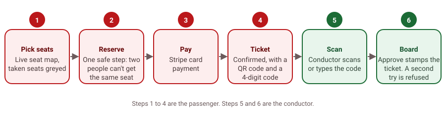
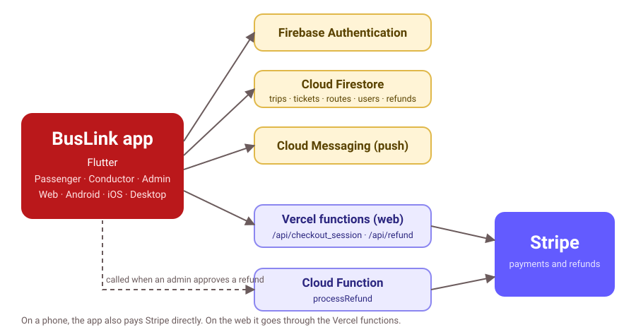
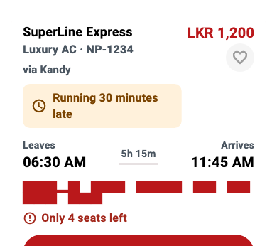
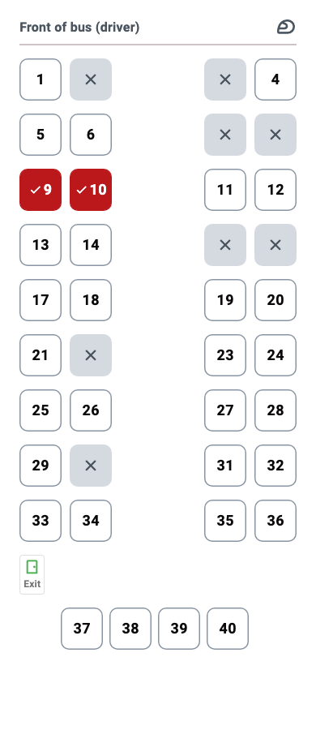
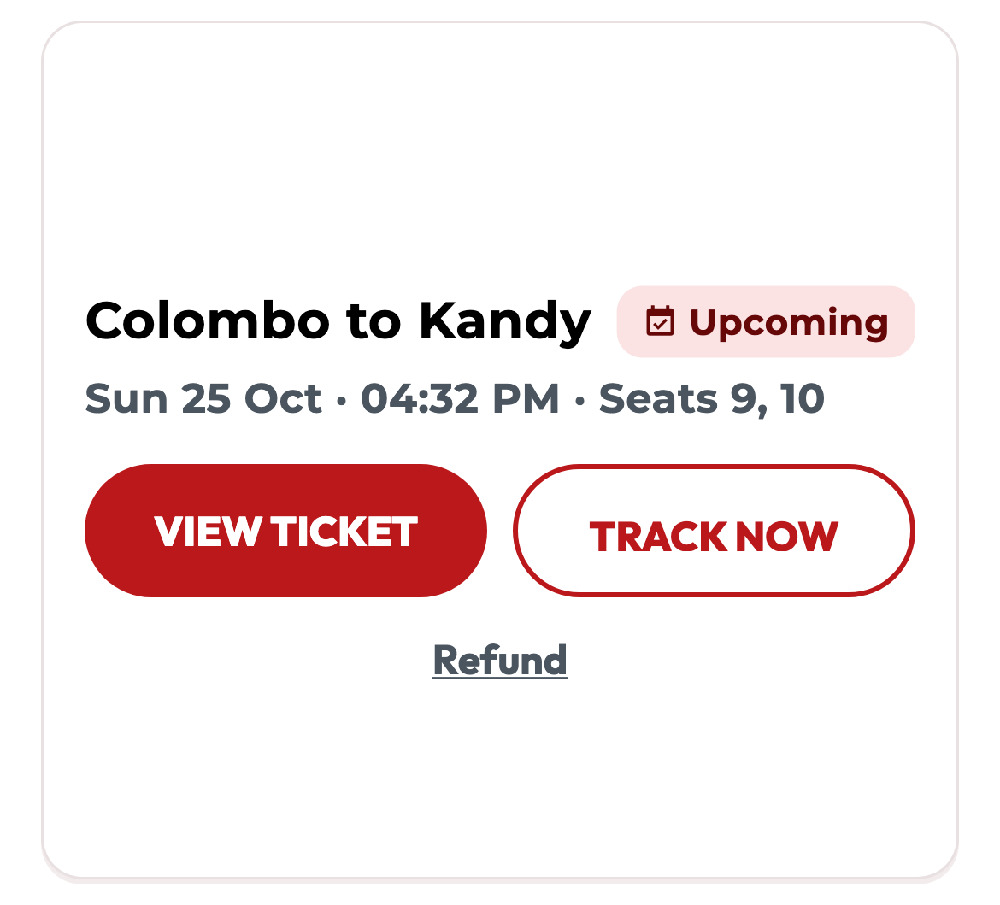
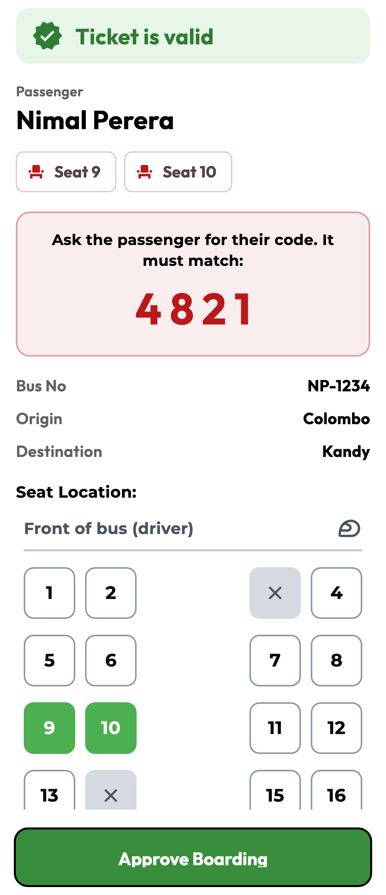
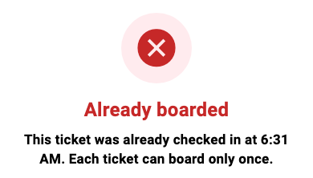

# BusLink

[](https://github.com/Hikki-dev/Buslink/actions/workflows/checks.yml)
[](https://github.com/Hikki-dev/Buslink/actions/workflows/uptime.yml)
[](https://buslink-eta.vercel.app)


Book a bus seat, pay, and show a ticket on your phone. One app for passengers, conductors and the people who run the buses.

<p align="center"></p>

A passenger finds a trip, picks seats on a live seat map, pays by card and gets a ticket with a QR code. The conductor scans it when the passenger boards. Admins manage routes, timetables, bookings, refunds and users.

Everything is written for people who are not used to apps: big buttons, plain words, no colour-only signals, and three languages (English, Sinhala and Tamil).

## On this page

* [Try it first](#try-it-first): the live demo
* [What you get](#what-you-get): for passengers, conductors and admins
* [How everything fits together](#how-everything-fits-together)
* [Using the app](#using-the-app) (the full walk through is in [Getting started](docs/Getting%20started.md))
  * [Passengers](#passengers)
  * [Conductors](#conductors)
  * [Admins](#admins)
* [Before you start](#before-you-start): what you need to run it yourself
* [Run it yourself](#run-it-yourself)
* [Tests](#tests)
* [Your privacy and safety](#your-privacy-and-safety)
* [Help and more reading](#help-and-more-reading)
* [Legal and responsibility](#legal-and-responsibility)

## Try it first

**[Open the live demo](https://buslink-eta.vercel.app).** It is the real app running on the web.

* Press **Sign Up** to make a passenger account. New accounts are always passengers.
* To pay, use Stripe's test card `4242 4242 4242 4242`, any future date and any three digits. The demo is built with Stripe **test** keys. Never type a real card number into it.
* Conductor and admin screens need an account that the owner has given that role. See [Roles](docs/Installing.md#7-roles).

The **Demo status** badge at the top of this page turns red if the demo goes down. A small check runs every six hours (see [Deploying](docs/Deploying.md)). The **Checks** badge shows that the code and the docs pass their tests.

## What you get

| For | What it does |
|---|---|
| **Passengers** | Search by route and date. See clear bus cards with the time, how long it takes, how many seats are left and whether the bus is late. Pick seats on a live seat map. Pay by card. Keep tickets in My Trips. Track the bus on a map. Ask for a refund and watch its progress. Save favourite routes. Book several dates at once. |
| **Conductors** | See their trips. Scan a ticket or type its 4-digit code. Approve boarding, and be told if a ticket was already used. Report a delay. Change the trip status. Book walk-up passengers who have no app. |
| **Admins** | Add and edit trips in three simple steps. Manage routes and timetables. Browse bookings with clear status chips. Review and process refunds. Manage who is a conductor or admin. See revenue and late-departure reports. Read feedback. |

Also: sign in with email, Google or phone number, push notifications and trip reminders, light and dark themes, and tickets that can be saved as PDF.

## How everything fits together

The app talks to Firebase for sign-in, data and push messages. Payments go to Stripe, from the phone directly or through two small functions on the web.

<p align="center"><a href="docs/images/how-it-fits.svg"></a></p>

The full story, including every collection in the database and how a booking is kept safe from double-booking, is in [How everything fits](docs/How%20everything%20fits.md).

## Using the app

Every picture below is drawn by the real app code, so it shows what you will get. (The pictures use a stand-in font, so the letters look slightly different on a phone.)

### Passengers

**1. Choose a bus.** Each bus card shows who runs it, the times in plain 12-hour format, how long the trip takes and how many seats are left. A late bus says so in words ("Running 30 minutes late"). A cancelled or full bus cannot be selected.



**2. Choose your seats.** The seat map is live. Seats someone else has taken are grey with a cross. Your seats show a tick. Every seat can be read out by a screen reader ("Seat 9, selected").



**3. Pay and get your ticket.** Pay by card. Your ticket has a QR code and a 4-digit code. Show either to the conductor.

**4. My Trips.** Every ticket has one big **View** button. **Track bus** appears when the bus is on its way, is late, or leaves within three hours. **Refund** is a quiet link, so nobody taps it by accident.



**5. Refunds.** After a request, a simple three-step line shows where it is: Sent, In review, then Approved or Rejected.


More in the [Passenger guide](docs/Passenger%20guide.md).

### Conductors

**Check a ticket.** Scan the QR code, or type the ticket code. The result is a big green "Ticket is valid" with the passenger's name, their seats, and the 4-digit code to compare with the passenger's own screen. Press **Approve Boarding** to record it.



**A ticket can board only once.** Approving stamps the ticket with the time and who approved it. If someone shows the same ticket again, the conductor sees this instead:



**Late bus?** Press the delay button and choose 15, 30, 45, 60 or 90 minutes, or type your own. Passengers are told straight away.


More in the [Conductor guide](docs/Conductor%20guide.md).

### Admins

**Status you can read at a glance.** Every status has a colour, an icon and a word, so it works for everyone, including people who cannot tell red from green.


**Add a trip in three steps.** Route, then Schedule, then Fare and bus. Next checks only what you can see, and Back keeps what you typed.


More in the [Admin guide](docs/Admin%20guide.md).

## Before you start

To run your own copy you need:

1. [Flutter](https://docs.flutter.dev/get-started/install) 3.38 or newer.
2. A free [Firebase](https://console.firebase.google.com/) project, with Email/Password, Google and Phone sign-in turned on, and a Firestore database.
3. A [Stripe](https://stripe.com) account in **test mode**.
4. Node.js 18 or newer, for the data scripts.

## Run it yourself

```bash
git clone https://github.com/Hikki-dev/Buslink.git
cd Buslink
flutter pub get
```

Then, once:

1. Create `lib/firebase_options.dart` for **your** Firebase project (`flutterfire configure`).
2. Create a `.env` file in the project folder. The build fails without it.
3. Deploy the database rules, and add some trips.

```bash
flutter run             # Android or iOS
flutter run -d chrome   # Web
```

Every step is explained, with the exact keys and commands, in [Installing](docs/Installing.md). Putting the web version online for free is in [Deploying](docs/Deploying.md).

## Tests

```bash
flutter analyze
flutter test
python3 tool/check_docs.py   # links and pictures in the docs
```

The same three checks run on every pull request (the **Checks** badge above).

The tests cover the parts that are easy to get wrong: the boarding rule, the arrival-time maths, the refund progress, the three-step trip form, the bus and ticket cards, and the status chips. See [Testing](docs/Testing.md), which also shows how to remake the pictures in this README.

## Your privacy and safety

* A passenger can only see their own tickets and profile.
* **Nobody can choose their own role.** A new account is always a passenger. Only an admin can make someone a conductor or admin (in the repository's rules; make sure you have deployed them, see [Security](SECURITY.md)).
* Two people cannot book the same seat, and one ticket cannot board twice. Both are checked in a single safe step on the server, not just on the screen.
* Card details go straight to Stripe. BusLink never sees or stores them.
* The hidden debug login only exists in developer builds. It is not in the live app.

Some parts were built as coursework and need hardening before real money is involved. They are listed honestly in [Security](SECURITY.md).

## Help and more reading

| If you want to | Read |
|---|---|
| Follow the app from the first screen to a boarded ticket | [Getting started](docs/Getting%20started.md) |
| Run your own copy | [Installing](docs/Installing.md) |
| Put it online | [Deploying](docs/Deploying.md) |
| Learn each passenger screen | [Passenger guide](docs/Passenger%20guide.md) |
| Learn the conductor screens | [Conductor guide](docs/Conductor%20guide.md) |
| Learn the admin screens | [Admin guide](docs/Admin%20guide.md) |
| Understand how it works for people | [How everything fits](docs/How%20everything%20fits.md) |
| See what is stored and who can change it | [Data and rules](docs/Data%20and%20rules.md) |
| Read or change the code | [How it works](docs/How%20it%20works.md) |
| See the look and the rules it follows | [Design](docs/Design.md) |
| Fix a problem | [Fixing problems](docs/Fixing%20problems.md) |
| Find a quick answer | [Questions and answers](docs/FAQ.md) |
| Set up Stripe | [Stripe setup](STRIPE_SETUP.md) |
| Run or write tests | [Testing](docs/Testing.md) |
| Report a security problem | [Security](SECURITY.md) |
| Contribute a change | [Contributing](CONTRIBUTING.md) |
| See what changed | [Changes](CHANGELOG.md) |

## Legal and responsibility

* BusLink is a portfolio and learning project. It is not a licensed ticketing service.
* Use Stripe in test mode unless you have made the changes listed in [Security](SECURITY.md) first.
* Photos in the design mockups are from Wikimedia Commons, with credit to the photographers in the [Design](docs/Design.md#photo-credits) page.
* Built by [Yusuf (Hikki-dev)](https://github.com/Hikki-dev).
