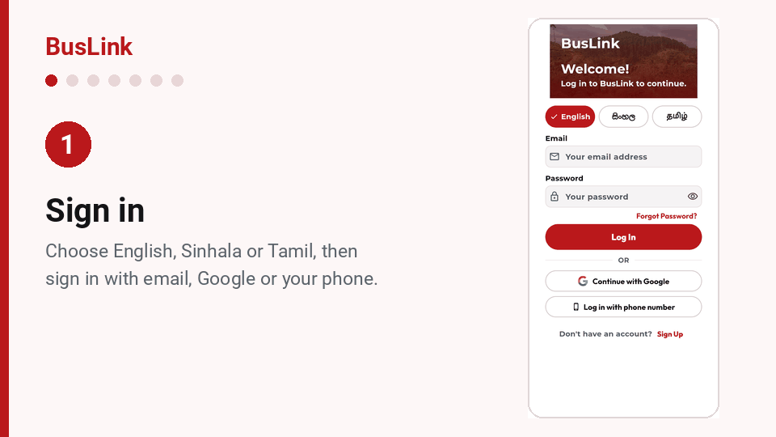
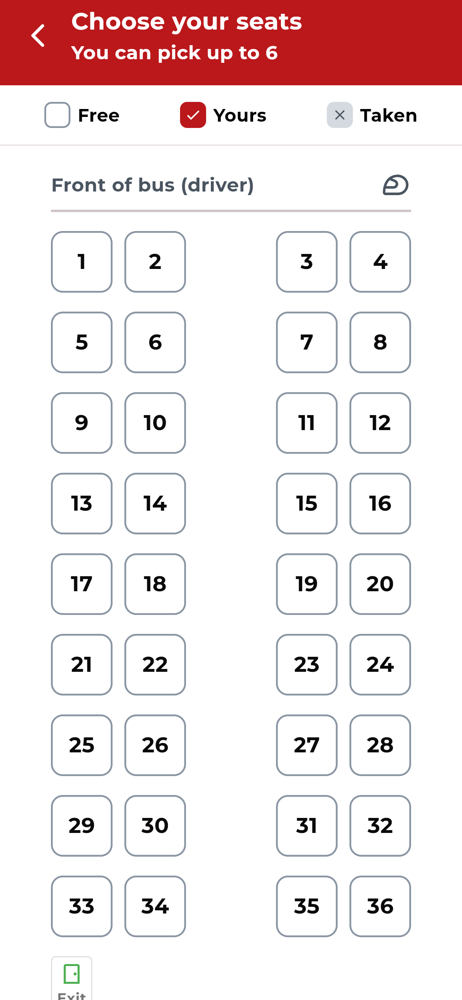
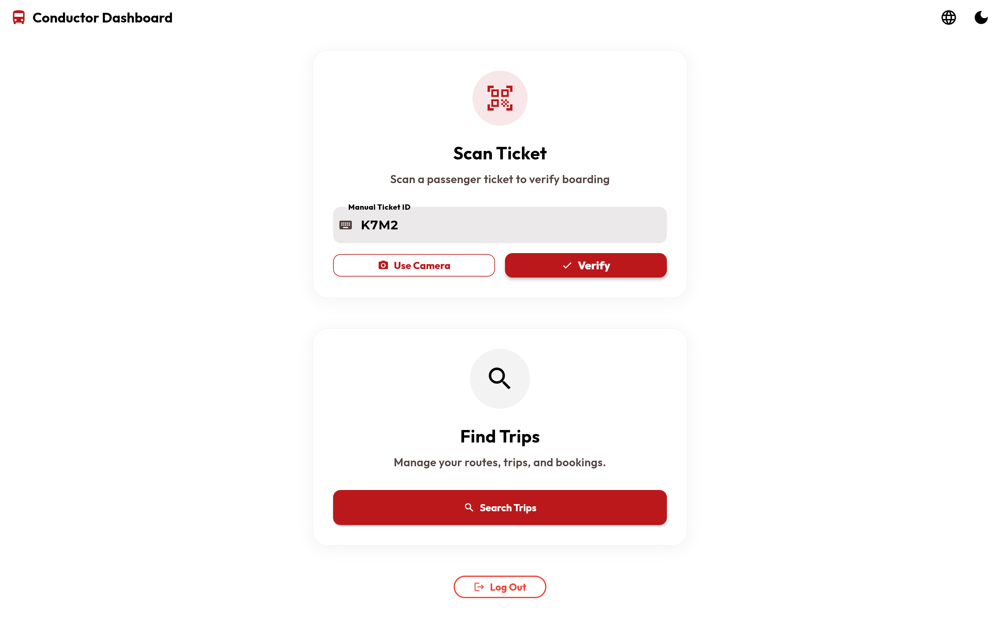
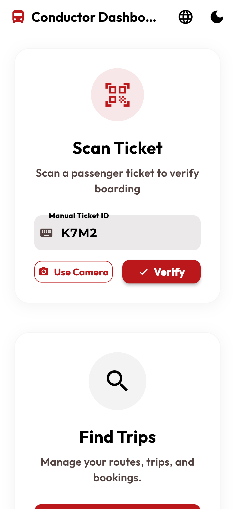
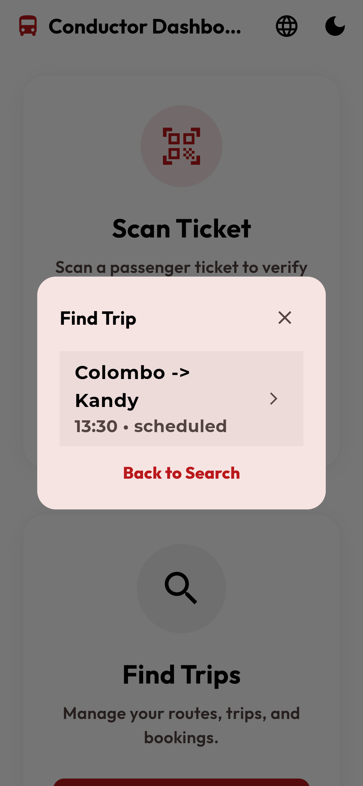
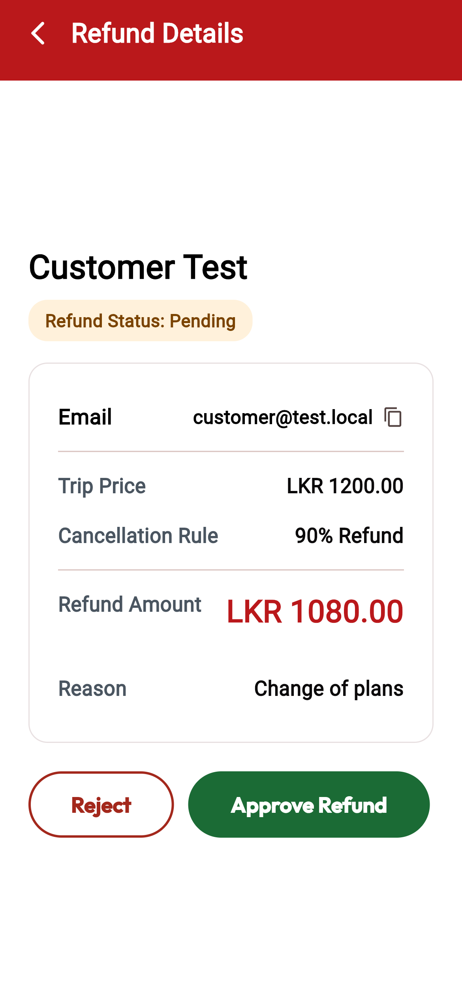
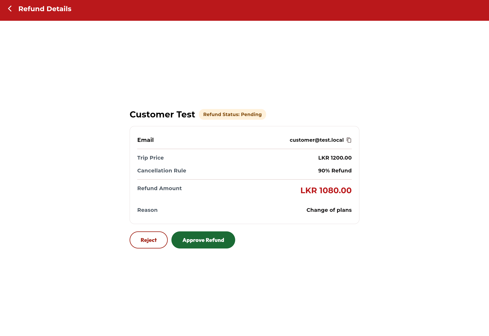
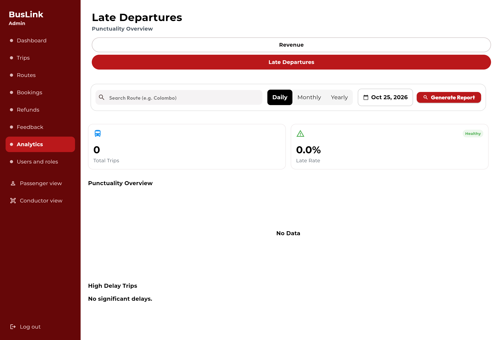

# BusLink

[](https://github.com/Hikki-dev/Buslink/actions/workflows/checks.yml)
[](https://github.com/Hikki-dev/Buslink/actions/workflows/uptime.yml)
[](https://buslink-eta.vercel.app)
[](LICENSE)

Book a bus seat, pay, and show a ticket on your phone. One app for passengers, conductors and the people who run the buses.

<p align="center"></p>

<p align="center"><sub>One trip, from sign-in to boarding, in seven scenes. <b><a href="https://buslink-eta.vercel.app">Open the live app</a></b> and follow along.</sub></p>

A passenger finds a trip, picks seats on a live seat map, pays by card and gets a ticket with a QR code. The conductor scans it when the passenger boards, and the ticket can never be used twice. Admins plan the trips, watch the bookings and handle refunds.

You do not need to know how any of it works. Every screen uses big buttons and plain words, never shows a status by colour alone, and speaks three languages: English, Sinhala and Tamil.

## On this page

* [What you get](#what-you-get): who it is for, and what it is built with
* [How everything fits together](#how-everything-fits-together)
* [Try it first](#try-it-first): the live app, or your own copy with test accounts
* [The story, step by step](#the-story-step-by-step)
  * [Part 1: The passenger](#part-1-the-passenger)
    * [1. Sign in](#1-sign-in)
    * [2. Find a bus](#2-find-a-bus)
    * [3. Your favourite routes](#3-your-favourite-routes)
    * [4. Choose a bus](#4-choose-a-bus)
    * [5. About the bus](#5-about-the-bus)
    * [6. Choose your seats](#6-choose-your-seats)
    * [7. Pay](#7-pay)
    * [8. Your ticket](#8-your-ticket)
    * [9. Follow the bus](#9-follow-the-bus)
    * [10. My Trips](#10-my-trips)
    * [11. If plans change](#11-if-plans-change)
    * [12. Your travel numbers](#12-your-travel-numbers)
    * [13. Notifications](#13-notifications)
    * [14. Profile and settings](#14-profile-and-settings)
    * [15. Help and support](#15-help-and-support)
  * [Part 2: The conductor](#part-2-the-conductor)
    * [16. The conductor's home](#16-the-conductors-home)
    * [17. Check a ticket](#17-check-a-ticket)
    * [18. Once only](#18-once-only)
    * [19. Find a trip and report a delay](#19-find-a-trip-and-report-a-delay)
  * [Part 3: The admin](#part-3-the-admin)
    * [20. Upcoming trips](#20-upcoming-trips)
    * [21. Add a trip](#21-add-a-trip)
    * [22. Routes and schedules](#22-routes-and-schedules)
    * [23. Bookings](#23-bookings)
    * [24. Refunds](#24-refunds)
    * [25. Feedback and analytics](#25-feedback-and-analytics)
    * [26. Users and roles](#26-users-and-roles)
* [Every screen in one place](#every-screen-in-one-place)
* [What keeps it safe](#what-keeps-it-safe)
* [Run it yourself](#run-it-yourself)
* [Tests](#tests)
* [Your privacy and safety](#your-privacy-and-safety)
* [Help and more reading](#help-and-more-reading)
* [Legal and responsibility](#legal-and-responsibility)

## What you get

One app, three people. Each one sees only the screens they need.

| Who | What they do |
|---|---|
| **Passengers** | Search by route and date, pick seats on a live map, pay by card, keep tickets in My Trips, track the bus, ask for refunds, save favourite routes and book several dates at once |
| **Conductors** | Scan a ticket or type its code, approve boarding, report a delay, change a trip's status and book walk-up passengers who have no app |
| **Admins** | Add trips and timetables, browse bookings, review refunds, manage who is a conductor or admin, and read the revenue and late-departure reports |

It also signs people in with email, Google or a phone number, sends push notifications and trip reminders, and works in light and dark themes. Tickets can be saved as a PDF.

### What it is built with

<table>
<tr><td width="64"></td><td width="170"><b>Flutter</b></td><td>One app for phones, the web and desktop</td></tr>
<tr><td></td><td><b>Dart</b></td><td>The language Flutter is written in</td></tr>
<tr><td></td><td><b>Firebase</b></td><td>Sign-in, the database (Firestore) and push messages</td></tr>
<tr><td></td><td><b>Google Sign-In</b></td><td>"Continue with Google" on the sign-in page</td></tr>
<tr><td></td><td><b>Stripe</b></td><td>Card payments and refunds. Card details never touch BusLink</td></tr>
<tr><td></td><td><b>Vercel</b></td><td>Hosts the web app and the two small payment functions</td></tr>
</table>

## How everything fits together

A trip is one story with two halves. The passenger books, and later the conductor boards them.

<p align="center"><a href="docs/images/booking-flow.svg"></a></p>

Behind the screens, the app talks to Firebase for sign-in, data and push messages. Payments go to Stripe, from the phone directly or through two small functions on the web.

<p align="center"><a href="docs/images/how-it-fits.svg"></a></p>

The full story, including every collection in the database, is in [How everything fits](docs/How%20everything%20fits.md). The walk through below follows the same steps.

## Try it first

**[Open the live demo](https://buslink-eta.vercel.app).** It is the real app running on the web.

* Press **Sign Up** to make a passenger account. New accounts are always passengers.
* To pay, use Stripe's test card `4242 4242 4242 4242`, any future date and any three digits. The demo is built with Stripe **test** keys. Never type a real card number into it.
* Conductor and admin screens need an account that the owner has given that role. See [Roles](docs/Installing.md#7-roles).

The **Demo status** badge at the top of this page turns red if the demo goes down. A small check runs every six hours (see [Deploying](docs/Deploying.md)). The **Checks** badge shows that the code and the docs pass their tests.

### Or try every role on your own computer

You can run the whole app against a pretend Firebase on your own computer. Nothing is sent anywhere, and it comes with a customer, a conductor and an admin to sign in as. This is how every picture on this page was taken. The steps are in [Try it on your computer](docs/Try%20it%20on%20your%20computer.md).

## The story, step by step

Every picture is the real app, taken from the running web version at twice the usual sharpness. Click a picture to see it full size. The wide picture is the computer view, and the tall ones below it are the phone view. The full walk through, with a little more detail for each screen, is in [Getting started](docs/Getting%20started.md), and [Every screen in one place](#every-screen-in-one-place) lists them all.

### Part 1: The passenger

It starts with someone who wants to get from Colombo to Kandy.

#### 1. Sign in

<p align="center"><a href="docs/images/passenger-1-sign-in.jpg"></a></p>

<p align="center">
<a href="docs/images/passenger-1-sign-in-phone.png"></a>
<a href="docs/images/passenger-1-sign-up-phone.png"></a>
<a href="docs/images/passenger-1-phone-phone.png"></a>
</p>

While the app opens, a short scene plays: a bus drives from Colombo through Kandy to Ella, and a line says what is happening (more in [Starting up](docs/Starting%20up.md)).

Choose English, Sinhala or Tamil with the three buttons at the top. Sign in with email, with Google, or with a phone number: you type your number, and a six-digit code arrives by text. **Sign Up** makes a new account. A new account is always a passenger. Nobody can pick a higher role for themselves.

#### 2. Find a bus

<p align="center"><a href="docs/images/passenger-2-search.jpg"></a></p>

<p align="center">
<a href="docs/images/passenger-2-search-phone.png"></a>
</p>

Choose where from, where to and the day, then press **Search Buses**. The little arrows swap the two cities. Tick **Bulk booking** to book several days in one go. Below the search, your favourite routes and your next trips are one tap away.

**Booking several days at once.** Tick **Bulk booking**, press the box that now says "days chosen", and tap each day you travel. Press **Search Buses**, choose a bus, and say how many people are travelling each day. A summary lists every date, the price per ticket and the total before you pay once. Each day gets its own ticket.

<p align="center"><a href="docs/images/bulk-2-dates.jpg"></a></p>

<p align="center">
<a href="docs/images/bulk-2-dates-phone.png"></a>
<a href="docs/images/bulk-3-passengers-phone.png"></a>
<a href="docs/images/bulk-4-summary-phone.png"></a>
</p>

#### 3. Your favourite routes

<p align="center"><a href="docs/images/passenger-3-favourites.png"></a></p>

<p align="center">
<a href="docs/images/passenger-3-favourites-phone.png"></a>
</p>

Press the heart on any trip to keep the route. **Book again** fills in the search for you.

#### 4. Choose a bus

<p align="center"><a href="docs/images/passenger-4-results.png"></a></p>

<p align="center">
<a href="docs/images/passenger-4-results-phone.png"></a>
</p>

Each result is one card: who runs the bus, the times in plain 12-hour format, how long it takes and how many seats are left. The filters narrow the list by time of day and hide full buses. If something is wrong, the card says so in words.


A cancelled or full bus has a grey button that cannot be pressed, and pressing it explains why. Otherwise, press **Book Now**, or the red line under the bus name to see what is on it first.

#### 5. About the bus

<p align="center"><a href="docs/images/passenger-5-bus-details.png"></a></p>

<p align="center">
<a href="docs/images/passenger-5-bus-details-phone.png"></a>
</p>

You see the times, the **platform** when the operator has set one, what is on the bus (air conditioning, WiFi) and every stop on the way. Press **Choose seats** to carry on.

#### 6. Choose your seats

<p align="center"><a href="docs/images/passenger-6-seats-chosen.png"></a></p>

<p align="center">
<a href="docs/images/passenger-6-seats-phone.png"></a>
<a href="docs/images/passenger-6-seats-chosen-phone.png"></a>
</p>

The seat map is live. Seats someone else has taken are grey with a cross. Your seats show a tick. You can choose up to six. Every seat can be read out by a screen reader ("Seat 9, selected"), and every seat can be chosen with one, too.


When you continue, the seats are checked and reserved together in one step, so two people can never get the same seat. If someone was a moment faster, you are told and can choose again.

#### 7. Pay

<p align="center"><a href="docs/images/passenger-7-payment.png"></a></p>

<p align="center">
<a href="docs/images/passenger-7-payment-phone.png"></a>
</p>

Check the summary, then press **Proceed to Pay**. On the phone a payment sheet opens. On the web you are taken to Stripe's secure page and sent back. Card details go straight to Stripe. If a payment fails or is cancelled, a card says what happened and offers the way on.


#### 8. Your ticket

<p align="center"><a href="docs/images/passenger-8-ticket.png"></a></p>

<p align="center">
<a href="docs/images/passenger-8-ticket-phone.png"></a>
</p>

You are shown **Payment Confirmed** and your ticket: a **QR code** for the conductor to scan, and a **4-character code** to read out if scanning does not work. The ticket is also kept in **My Trips**, and can be saved as a PDF.

Straight after paying you land on **Booking Confirmed**, with the same QR code and code, a button to save the ticket as a PDF, one to send it by text message, and a link to keep the route in your favourites.

<p align="center"><a href="docs/images/passenger-8-confirmed.png"></a></p>

<p align="center">
<a href="docs/images/passenger-8-confirmed-phone.png"></a>
</p>

#### 9. Follow the bus

<p align="center"><a href="docs/images/passenger-9-tracking.jpg"></a></p>

<p align="center">
<a href="docs/images/passenger-9-tracking-phone.jpg"></a>
</p>

**Track bus** opens a full-screen map. The bus shows as a pulsing dot, using the location the conductor's phone reports for that trip. One card says how long is left, worked out from the timetable plus any delay, and names the next stop. When there is no live location yet, it says so and uses the timetable. Within five minutes of arriving it turns into "Your bus is almost here", with a **Show my ticket** button.

#### 10. My Trips

<p align="center"><a href="docs/images/passenger-10-my-trips.png"></a></p>

<p align="center">
<a href="docs/images/passenger-10-my-trips-phone.png"></a>
<a href="docs/images/empty-trips-phone.png"></a>
</p>

Every ticket is one card with one big **View ticket** button. Before the first booking, a short message says what to do. The tabs sort them into Upcoming, Completed, Cancelled and Delayed. **Track bus** appears only when it is useful: the bus is on its way, is running late, or leaves within three hours. **Refund** is a small link, kept quiet on purpose so it is not pressed by accident.


#### 11. If plans change

<p align="center"><a href="docs/images/passenger-11-refund.png"></a></p>

<p align="center">
<a href="docs/images/passenger-11-refund-phone.png"></a>
</p>

Press **Refund**, read how much you get back (the earlier you cancel, the more), choose a reason and send it. A three-step line then shows where it is: Sent, In review, then Approved or Rejected.


#### 12. Your travel numbers

<p align="center"><a href="docs/images/passenger-12-travel-numbers.png"></a></p>

<p align="center">
<a href="docs/images/passenger-12-travel-numbers-phone.png"></a>
</p>

A friendly summary of your trips: how many are coming up, how many you have taken, what you have spent, your favourite destination and your busiest month.

#### 13. Notifications

<p align="center"><a href="docs/images/passenger-13-notifications.png"></a></p>

<p align="center">
<a href="docs/images/passenger-13-notifications-phone.png"></a>
<a href="docs/images/passenger-14-notification-settings-phone.png"></a>
</p>

You hear about delays, cancellations, refunds and reminders. The bell shows how many are new. Press **Mark all as read**, or open the settings to choose what you want to hear about. The first time, the app asks if it may send notifications. Answer once: **Allow** is remembered for good, and **Later** waits a week.

#### 14. Profile and settings

<p align="center"><a href="docs/images/passenger-14-profile.png"></a></p>

<p align="center">
<a href="docs/images/passenger-14-profile-phone.png"></a>
<a href="docs/images/passenger-14-settings-phone.png"></a>
<a href="docs/images/passenger-14-feedback-phone.png"></a>
</p>

Change your name and phone number, link your Google account, switch the language or dark mode, and tell us what you think with **Send Feedback**.

#### 15. Help and support

<p align="center"><a href="docs/images/passenger-15-support.png"></a></p>

<p align="center">
<a href="docs/images/passenger-15-support-phone.png"></a>
</p>

Answers to the questions people ask most, a message form that opens your email app, the emergency numbers for Sri Lanka, and one-tap buttons to call or email support.

That is the passenger's whole journey. More detail is in the [Passenger guide](docs/Passenger%20guide.md). Now the other person in the story: the conductor, at the door of the bus.

### Part 2: The conductor

The passenger walks up with a phone. The conductor has about five seconds.

#### 16. The conductor's home

<p align="center"><a href="docs/images/conductor-1-home.png"></a></p>

<p align="center">
<a href="docs/images/conductor-1-home-phone.png"></a>
</p>

Two big jobs, one under the other: **Scan Ticket** (use the camera, or type the code and press **Verify**) and **Find Trips**. The app asks to use the phone's location so passengers can see where their bus is. Saying no is fine, and nothing else changes.

#### 17. Check a ticket

<p align="center"><a href="docs/images/conductor-2-verified.png"></a></p>

<p align="center">
<a href="docs/images/conductor-2-verified-phone.png"></a>
</p>

The answer is a big green "Ticket is valid" with the passenger's name, their seats, and the code to compare with the passenger's own screen. The same works for the long ticket number in the QR code and for the short code on the ticket. When they match, press **Approve Boarding**.


Approving saves the time and the conductor on the ticket. If there is no signal, the app says so and keeps the card open. It never shows a boarding as saved when it was not.

#### 18. Once only

<p align="center"><a href="docs/images/conductor-3-boarded.png"></a></p>

<p align="center">
<a href="docs/images/conductor-3-boarded-phone.png"></a>
</p>

A ticket boards once. If someone shows the same ticket again, even to a different conductor a moment later, the conductor sees this instead:


The check and the stamp happen together on the server, and the database rules enforce it too, so it holds even if someone tries to get around the app.

#### 19. Find a trip and report a delay

<p align="center"><a href="docs/images/conductor-4-results.png"></a></p>

<p align="center">
<a href="docs/images/conductor-4-find-trips-phone.png"></a>
<a href="docs/images/conductor-4-results-phone.png"></a>
</p>

Choose where from, where to and the day, then pick the trip. If the bus is late, press the delay button and choose 15, 30, 45, 60 or 90 minutes, or type your own. Passengers with a ticket are told straight away, and their bus card says "Running 30 minutes late".


More in the [Conductor guide](docs/Conductor%20guide.md). The last person in the story never sees a bus at all, but makes the whole thing possible.

### Part 3: The admin

Before any passenger can book, someone has to have planned the trips. On a computer, the admin has a dark red menu down the left side. On a phone, the same pages are tiles, with a bar at the bottom.

#### 20. Upcoming trips

<p align="center"><a href="docs/images/admin-1-trips.png"></a></p>

<p align="center">
<a href="docs/images/admin-1-trips-phone.png"></a>
</p>

The next 30 days of trips, with how many seats are taken and whether each is on time. Deleting a trip tells you how many seats are already booked before it asks you to confirm.

#### 21. Add a trip

<p align="center"><a href="docs/images/admin-2-trip-form.png"></a></p>

<p align="center">
<a href="docs/images/admin-2-trip-form-phone.png"></a>
</p>

The trip form has three short steps: Route, then Schedule, then Fare and bus. You can fill in the **platform** (optional) so passengers know where to wait. **Next** checks only what you can see, and **Back** keeps what you typed. Nothing is saved until the last step.


#### 22. Routes and schedules

<p align="center"><a href="docs/images/admin-3-routes.png"></a></p>

<p align="center">
<a href="docs/images/admin-3-routes-phone.png"></a>
</p>

A **route** is the path. A **schedule** says which bus runs it and when, and can carry a default platform. **Generate Trips** makes the trips for the coming days from a schedule.

#### 23. Bookings

<p align="center"><a href="docs/images/admin-4-bookings.png"></a></p>

<p align="center">
<a href="docs/images/admin-4-bookings-phone.png"></a>
</p>

Every booking has a status you can read at a glance. Each is an icon, a word and a colour together, so it works for everyone, including people who cannot tell red from green. A checked-in ticket shows **Boarded**.

Open a booking to see the trip, the passenger and what was paid.

<p align="center"><a href="docs/images/admin-4-booking-details.png"></a></p>

<p align="center">
<a href="docs/images/admin-4-booking-details-phone.png"></a>
</p>


#### 24. Refunds

<p align="center"><a href="docs/images/admin-5-refunds.png"></a></p>

<p align="center">
<a href="docs/images/admin-5-refunds-phone.png"></a>
<a href="docs/images/admin-5-refund-details-phone.png"></a>
</p>

Refund requests arrive in a list with three tabs, Pending, Approved and Rejected. Open one to see why the passenger asked and how much they get back. Approving one returns the money to the passenger's card through Stripe. Rejecting asks for a reason from a short list.

<p align="center"><a href="docs/images/admin-5-refund-details.png"></a></p>

#### 25. Feedback and analytics

<p align="center"><a href="docs/images/admin-6-feedback.png"></a></p>

<p align="center">
<a href="docs/images/admin-6-feedback-phone.png"></a>
<a href="docs/images/admin-7-analytics-phone.png"></a>
</p>

Read what passengers wrote and how many stars they gave. **Analytics** shows net revenue over time and the top routes, with a second tab for late departures.

<p align="center"><a href="docs/images/admin-7-late.png"></a></p>

<p align="center"><a href="docs/images/admin-7-analytics.png"></a></p>

#### 26. Users and roles

<p align="center"><a href="docs/images/admin-8-users.png"></a></p>

<p align="center">
<a href="docs/images/admin-8-users-phone.png"></a>
</p>

A new account is a passenger. Only an admin can make someone a conductor or admin, here. The app notices a role change at once, with no sign-out. This is enforced by the database rules, not just the screens, and the rules have their own tests.

That closes the loop: the admin's trips are what the passenger searched for in step 2. More in the [Admin guide](docs/Admin%20guide.md).

## Every screen in one place

The design boards, one for each screen on a phone and on a computer, are listed in [Every screen](docs/Every%20screen.md) next to the picture of the finished screen. Start there to find a screen by name.

## What keeps it safe

Three checks run on the server in a single step each, so they cannot be skipped by a slow phone or a clever one.

* **No double booking.** Seats are checked and reserved together.
* **One boarding per ticket.** The ticket is checked and stamped together, and the rules only let a conductor stamp it once, as themselves.
* **No self-promotion.** Nobody can create or change their own role. A passenger cannot rewrite their own ticket's owner, price or seats, or mark it boarded.

These are proven by 43 automatic cases that run on every change. The honest list of what still needs doing before real money is in [Security](SECURITY.md).

## Run it yourself

You need [Flutter](https://docs.flutter.dev/get-started/install) 3.38 or newer, a free [Firebase](https://console.firebase.google.com/) project (with Email/Password, Google and Phone sign-in turned on, and a Firestore database), a [Stripe](https://stripe.com) account in **test mode**, and Node.js 18 or newer for the data scripts.

```bash
git clone https://github.com/Hikki-dev/Buslink.git
cd Buslink
flutter pub get
```

Then, once:

1. Create `lib/firebase_options.dart` for **your** Firebase project (`flutterfire configure`).
2. Create a `.env` file in the project folder. The build fails without it.
3. Deploy the database rules, exactly as they are in the repository, and add some trips.

```bash
flutter run             # Android or iOS
flutter run -d chrome   # Web
```

Every step is explained, with the exact keys and commands, in [Installing](docs/Installing.md). Putting the web version online for free is in [Deploying](docs/Deploying.md).

## Tests

```bash
flutter analyze
flutter test
python3 tool/check_docs.py   # links and pictures in the docs
```

The same checks run on every pull request (the **Checks** badge above), together with 43 cases that test the database rules in the Firebase emulator.

The tests cover the parts that are easy to get wrong: the boarding rule, the arrival-time maths, the refund progress, the three-step trip form, the bus and ticket cards, and the status chips. See [Testing](docs/Testing.md), which also shows how to remake the pictures in this README.

## Your privacy and safety

* A passenger can only see their own tickets and profile.
* **Nobody can choose their own role.** A new account is always a passenger.
* Two people cannot book the same seat, and one ticket cannot board twice. Both are checked on the server, not just on the screen.
* Card details go straight to Stripe. BusLink never sees or stores them.
* The hidden debug login only exists in developer builds. It is not in the live app.

Some parts were built as coursework and need hardening before real money is involved. They are listed honestly in [Security](SECURITY.md).

## Help and more reading

| If you want to | Read |
|---|---|
| Follow the app from the first screen to a boarded ticket | [Getting started](docs/Getting%20started.md) |
| Find a screen by its design name, with its picture | [Every screen](docs/Every%20screen.md) |
| Try every role on your own computer, with test accounts | [Try it on your computer](docs/Try%20it%20on%20your%20computer.md) |
| Run your own copy | [Installing](docs/Installing.md) |
| Put it online | [Deploying](docs/Deploying.md) |
| See what happens while it opens, and why it is fast | [Starting up](docs/Starting%20up.md) |
| Learn each passenger screen | [Passenger guide](docs/Passenger%20guide.md) |
| Learn the conductor screens | [Conductor guide](docs/Conductor%20guide.md) |
| Learn the admin screens | [Admin guide](docs/Admin%20guide.md) |
| Understand how it works for people | [How everything fits](docs/How%20everything%20fits.md) |
| See what is stored and who can change it | [Data and rules](docs/Data%20and%20rules.md) |
| Read or change the code | [How it works](docs/How%20it%20works.md) |
| See the look and the rules it follows | [Design](docs/Design.md) |
| Fix a problem | [Fixing problems](docs/Fixing%20problems.md) |
| Find a quick answer | [Questions and answers](docs/FAQ.md) |
| Set up Stripe | [Stripe setup](STRIPE_SETUP.md) |
| Run or write tests | [Testing](docs/Testing.md) |
| Report a security problem | [Security](SECURITY.md) |
| Contribute a change | [Contributing](CONTRIBUTING.md) |
| See what changed | [Changes](CHANGELOG.md) |

## Legal and responsibility

* BusLink is a portfolio and learning project. It is not a licensed ticketing service.
* The code is released under the [MIT licence](LICENSE). It is provided as it is, with no promises. You are responsible for how you use it, especially with real payments (see [Security](SECURITY.md)).
* Use Stripe in test mode unless you have made the changes listed in [Security](SECURITY.md) first.
* Brand names and logos (Flutter, Dart, Firebase, Google, Stripe and Vercel) belong to their owners and are used only to say what BusLink is built with.
* Photos in the design mockups are from Wikimedia Commons, with credit to the photographers in the [Design](docs/Design.md#photo-credits) page.
* Built by [Yusuf (Hikki-dev)](https://github.com/Hikki-dev).
