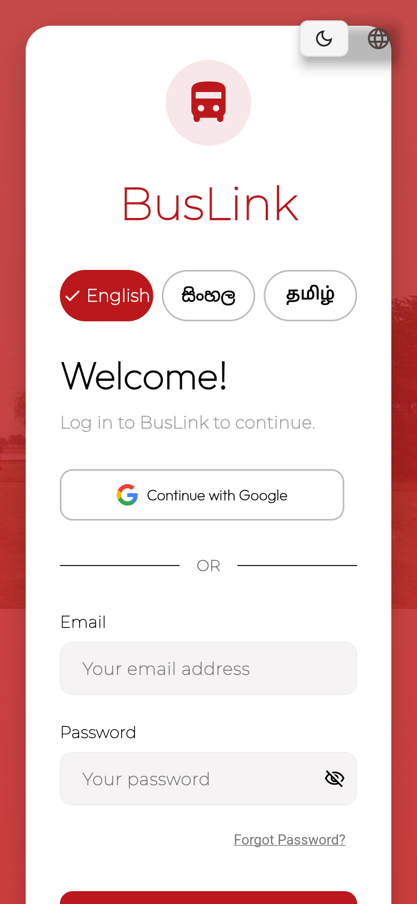

# BusLink

[](https://github.com/Hikki-dev/Buslink/actions/workflows/checks.yml)
[](https://github.com/Hikki-dev/Buslink/actions/workflows/uptime.yml)
[](https://buslink-eta.vercel.app)
[](LICENSE)

Book a bus seat, pay, and show a ticket on your phone. One app for passengers, conductors and the people who run the buses.

<p align="center"></p>

<p align="center"><sub>One trip, from sign-in to boarding, in six scenes. <b><a href="https://buslink-eta.vercel.app">Open the live app</a></b> and follow along.</sub></p>

A passenger finds a trip, picks seats on a live seat map, pays by card and gets a ticket with a QR code. The conductor scans it when the passenger boards, and the ticket can never be used twice. Admins plan the trips, watch the bookings and handle refunds.

You do not need to know how any of it works. Every screen uses big buttons and plain words, never shows a status by colour alone, and speaks three languages: English, Sinhala and Tamil.

## On this page

* [What you get](#what-you-get): who it is for, and what it is built with
* [How everything fits together](#how-everything-fits-together)
* [Try it first](#try-it-first)
* [The story, step by step](#the-story-step-by-step)
  * [Part 1: The passenger](#part-1-the-passenger): [1. Sign in](#1-sign-in), [2. Find a bus](#2-find-a-bus), [3. Choose your seats](#3-choose-your-seats), [4. Pay and get your ticket](#4-pay-and-get-your-ticket), [5. My Trips](#5-my-trips), [6. If plans change](#6-if-plans-change)
  * [Part 2: The conductor](#part-2-the-conductor): [7. Check a ticket](#7-check-a-ticket), [8. Once only](#8-once-only), [9. Running late](#9-running-late)
  * [Part 3: The admin](#part-3-the-admin): [10. Add a trip](#10-add-a-trip), [11. Watch bookings and refunds](#11-watch-bookings-and-refunds), [12. Who can do what](#12-who-can-do-what)
* [What keeps it safe](#what-keeps-it-safe)
* [Run it yourself](#run-it-yourself)
* [Tests](#tests)
* [Your privacy and safety](#your-privacy-and-safety)
* [Help and more reading](#help-and-more-reading)
* [Legal and responsibility](#legal-and-responsibility)

## What you get

One app, three people. Each one sees only the screens they need.

| Who | What they do |
|---|---|
| **Passengers** | Search by route and date, pick seats on a live map, pay by card, keep tickets in My Trips, track the bus, ask for refunds, save favourite routes and book several dates at once |
| **Conductors** | Scan a ticket or type its code, approve boarding, report a delay, change a trip's status and book walk-up passengers who have no app |
| **Admins** | Add trips and timetables, browse bookings, review refunds, manage who is a conductor or admin, and read the revenue and late-departure reports |

It also signs people in with email, Google or a phone number, sends push notifications and trip reminders, and works in light and dark themes. Tickets can be saved as a PDF.

### What it is built with

<table>
<tr><td width="64"></td><td width="170"><b>Flutter</b></td><td>One app for phones, the web and desktop</td></tr>
<tr><td></td><td><b>Dart</b></td><td>The language Flutter is written in</td></tr>
<tr><td></td><td><b>Firebase</b></td><td>Sign-in, the database (Firestore) and push messages</td></tr>
<tr><td></td><td><b>Google Sign-In</b></td><td>"Continue with Google" on the sign-in page</td></tr>
<tr><td></td><td><b>Stripe</b></td><td>Card payments and refunds. Card details never touch BusLink</td></tr>
<tr><td></td><td><b>Vercel</b></td><td>Hosts the web app and the two small payment functions</td></tr>
</table>

## How everything fits together

A trip is one story with two halves. The passenger books, and later the conductor boards them.

<p align="center"><a href="docs/images/booking-flow.svg"></a></p>

Behind the screens, the app talks to Firebase for sign-in, data and push messages. Payments go to Stripe, from the phone directly or through two small functions on the web.

<p align="center"><a href="docs/images/how-it-fits.svg"></a></p>

The full story, including every collection in the database, is in [How everything fits](docs/How%20everything%20fits.md). The walk through below follows the same six steps.

## Try it first

**[Open the live demo](https://buslink-eta.vercel.app).** It is the real app running on the web.

* Press **Sign Up** to make a passenger account. New accounts are always passengers.
* To pay, use Stripe's test card `4242 4242 4242 4242`, any future date and any three digits. The demo is built with Stripe **test** keys. Never type a real card number into it.
* Conductor and admin screens need an account that the owner has given that role. See [Roles](docs/Installing.md#7-roles).

The **Demo status** badge at the top of this page turns red if the demo goes down. A small check runs every six hours (see [Deploying](docs/Deploying.md)). The **Checks** badge shows that the code and the docs pass their tests.

## The story, step by step

Every picture below is drawn by the real app code, except the first, which is the live app. (The pictures use a stand-in font, so the letters look slightly different on a phone.) The full walk through, with the same pictures, is in [Getting started](docs/Getting%20started.md).

### Part 1: The passenger

It starts with someone who wants to get from Colombo to Kandy.

#### 1. Sign in

<a href="docs/images/login-live.png"></a>

While the app opens, a short scene plays: a bus drives from Colombo through Kandy to Ella, and a line says what is happening (more in [Starting up](docs/Starting%20up.md)).


Then choose English, Sinhala or Tamil with the three buttons at the top, and sign in with email, Google or a phone number. A new account is always a passenger. Nobody can pick a higher role for themselves.

#### 2. Find a bus

Choose where from, where to and the date, then press **Search**. Each result is one card: who runs the bus, the times in plain 12-hour format, how long it takes and how many seats are left. If something is wrong, the card says so in words.


A cancelled or full bus has a grey button that cannot be pressed, and pressing it explains why. Otherwise, press **Select**.

#### 3. Choose your seats

The seat map is live. Seats someone else has taken are grey with a cross. Your seats show a tick. Every seat can be read out by a screen reader ("Seat 9, selected").


When you continue, the seats are checked and reserved together in one step, so two people can never get the same seat. If someone was a moment faster, you are told and can choose again.

#### 4. Pay and get your ticket

Pay by card. On the phone a payment sheet opens. On the web you are taken to Stripe's secure page and sent back. Card details go straight to Stripe.

You are then shown **Payment Confirmed** and your ticket: a **QR code** for the conductor to scan, and a **4-digit code** to read out if scanning does not work. The ticket is also kept in **My Trips**, and can be saved as a PDF.

#### 5. My Trips

Every ticket is one card with one big **View** button. **Track bus** appears only when it is useful: the bus is on its way, is running late, or leaves within three hours. **Refund** is a small link, kept quiet on purpose so it is not pressed by accident.


**Track bus** opens a full-screen map. The bus shows as a pulsing dot, using the location the conductor's phone reports for that trip, and one card says how long is left, worked out from the timetable plus any delay.

#### 6. If plans change

Press **Refund**, choose a reason and send it. A three-step line then shows where it is: Sent, In review, then Approved or Rejected.


That is the passenger's whole journey. More detail is in the [Passenger guide](docs/Passenger%20guide.md). Now the other person in the story: the conductor, at the door of the bus.

### Part 2: The conductor

The passenger walks up with a phone. The conductor has about five seconds.

#### 7. Check a ticket

Scan the QR code, or type the ticket code if the camera will not work. The answer is a big green "Ticket is valid" with the passenger's name, their seats, and the 4-digit code to compare with the passenger's own screen. When they match, press **Approve Boarding**.


Approving saves the time and the conductor on the ticket. If there is no signal, the app says so and keeps the card open. It never shows a boarding as saved when it was not.

#### 8. Once only

A ticket boards once. If someone shows the same ticket again, even to a different conductor a moment later, the conductor sees this instead:


The check and the stamp happen together on the server, and the database rules enforce it too, so it holds even if someone tries to get around the app.

#### 9. Running late

If the bus is late, the conductor presses the delay button and chooses 15, 30, 45, 60 or 90 minutes, or types their own. Passengers with a ticket are told straight away, and their bus card says "Running 30 minutes late".


More in the [Conductor guide](docs/Conductor%20guide.md). The last person in the story never sees a bus at all, but makes the whole thing possible.

### Part 3: The admin

Before any passenger can book, someone has to have planned the trips.

#### 10. Add a trip

The trip form has three short steps: Route, then Schedule, then Fare and bus. **Next** checks only what you can see, and **Back** keeps what you typed. Nothing is saved until the last step.


#### 11. Watch bookings and refunds

Every booking and refund has a status you can read at a glance. Each is an icon, a word and a colour together, so it works for everyone, including people who cannot tell red from green. A checked-in ticket shows **Boarded**.


Refund requests arrive in a list with three tabs, Pending, Approved and Rejected. Approving one returns the money to the passenger's card through Stripe.

#### 12. Who can do what

A new account is a passenger. Only an admin can make someone a conductor or admin, from the **Roles** screen. The app notices a role change at once, with no sign-out. This is enforced by the database rules, not just the screens, and the rules have their own tests.

That closes the loop: the admin's trips are what the passenger searched for in step 2. More in the [Admin guide](docs/Admin%20guide.md).

## What keeps it safe

Three checks run on the server in a single step each, so they cannot be skipped by a slow phone or a clever one.

* **No double booking.** Seats are checked and reserved together.
* **One boarding per ticket.** The ticket is checked and stamped together, and the rules only let a conductor stamp it once, as themselves.
* **No self-promotion.** Nobody can create or change their own role. A passenger cannot rewrite their own ticket's owner, price or seats, or mark it boarded.

These are proven by 43 automatic cases that run on every change. The honest list of what still needs doing before real money is in [Security](SECURITY.md).

## Run it yourself

You need [Flutter](https://docs.flutter.dev/get-started/install) 3.38 or newer, a free [Firebase](https://console.firebase.google.com/) project (with Email/Password, Google and Phone sign-in turned on, and a Firestore database), a [Stripe](https://stripe.com) account in **test mode**, and Node.js 18 or newer for the data scripts.

```bash
git clone https://github.com/Hikki-dev/Buslink.git
cd Buslink
flutter pub get
```

Then, once:

1. Create `lib/firebase_options.dart` for **your** Firebase project (`flutterfire configure`).
2. Create a `.env` file in the project folder. The build fails without it.
3. Deploy the database rules, exactly as they are in the repository, and add some trips.

```bash
flutter run             # Android or iOS
flutter run -d chrome   # Web
```

Every step is explained, with the exact keys and commands, in [Installing](docs/Installing.md). Putting the web version online for free is in [Deploying](docs/Deploying.md).

## Tests

```bash
flutter analyze
flutter test
python3 tool/check_docs.py   # links and pictures in the docs
```

The same checks run on every pull request (the **Checks** badge above), together with 43 cases that test the database rules in the Firebase emulator.

The tests cover the parts that are easy to get wrong: the boarding rule, the arrival-time maths, the refund progress, the three-step trip form, the bus and ticket cards, and the status chips. See [Testing](docs/Testing.md), which also shows how to remake the pictures in this README.

## Your privacy and safety

* A passenger can only see their own tickets and profile.
* **Nobody can choose their own role.** A new account is always a passenger.
* Two people cannot book the same seat, and one ticket cannot board twice. Both are checked on the server, not just on the screen.
* Card details go straight to Stripe. BusLink never sees or stores them.
* The hidden debug login only exists in developer builds. It is not in the live app.

Some parts were built as coursework and need hardening before real money is involved. They are listed honestly in [Security](SECURITY.md).

## Help and more reading

| If you want to | Read |
|---|---|
| Follow the app from the first screen to a boarded ticket | [Getting started](docs/Getting%20started.md) |
| Run your own copy | [Installing](docs/Installing.md) |
| Put it online | [Deploying](docs/Deploying.md) |
| See what happens while it opens, and why it is fast | [Starting up](docs/Starting%20up.md) |
| Learn each passenger screen | [Passenger guide](docs/Passenger%20guide.md) |
| Learn the conductor screens | [Conductor guide](docs/Conductor%20guide.md) |
| Learn the admin screens | [Admin guide](docs/Admin%20guide.md) |
| Understand how it works for people | [How everything fits](docs/How%20everything%20fits.md) |
| See what is stored and who can change it | [Data and rules](docs/Data%20and%20rules.md) |
| Read or change the code | [How it works](docs/How%20it%20works.md) |
| See the look and the rules it follows | [Design](docs/Design.md) |
| Fix a problem | [Fixing problems](docs/Fixing%20problems.md) |
| Find a quick answer | [Questions and answers](docs/FAQ.md) |
| Set up Stripe | [Stripe setup](STRIPE_SETUP.md) |
| Run or write tests | [Testing](docs/Testing.md) |
| Report a security problem | [Security](SECURITY.md) |
| Contribute a change | [Contributing](CONTRIBUTING.md) |
| See what changed | [Changes](CHANGELOG.md) |

## Legal and responsibility

* BusLink is a portfolio and learning project. It is not a licensed ticketing service.
* The code is released under the [MIT licence](LICENSE). It is provided as it is, with no promises. You are responsible for how you use it, especially with real payments (see [Security](SECURITY.md)).
* Use Stripe in test mode unless you have made the changes listed in [Security](SECURITY.md) first.
* Brand names and logos (Flutter, Dart, Firebase, Google, Stripe and Vercel) belong to their owners and are used only to say what BusLink is built with.
* Photos in the design mockups are from Wikimedia Commons, with credit to the photographers in the [Design](docs/Design.md#photo-credits) page.
* Built by [Yusuf (Hikki-dev)](https://github.com/Hikki-dev).
