# BusLink

[](https://github.com/Hikki-dev/Buslink/actions/workflows/checks.yml)
[](https://buslink-eta.vercel.app/)


A bus booking and operations app for Sri Lanka. Passengers search a route, pick seats on a bus layout and pay. Conductors scan their ticket on board. Admins run the routes, the refunds and the numbers.

<p align="center">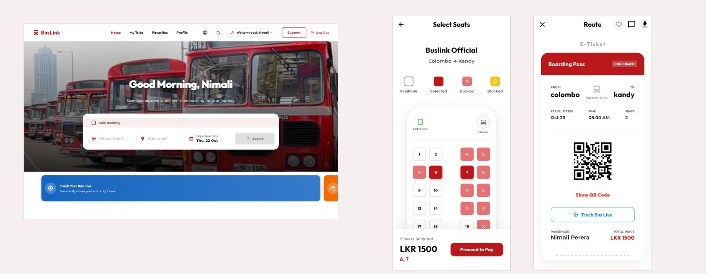</p>

<p align="center"><sub>Real screens of the running app with demo data. <b><a href="https://buslink-eta.vercel.app/">Open the live app</a></b>, or <a href="docs/Demo%20mode.md">run it yourself</a> with no Firebase project.</sub></p>

One Flutter code base runs on Android, iOS and the web, in English, Sinhala and Tamil. It has three kinds of account, and each one sees its own screens.

## On this page

* [What you get](#what-you-get)
* [How everything fits together](#how-everything-fits-together)
* [Try it first](#try-it-first): the live app, or a local copy with demo data
* [A tour of the screens](#a-tour-of-the-screens)
  * [Passengers](#passengers)
  * [Conductors](#conductors)
  * [Admins](#admins)
* [Run it with your own Firebase and Stripe](#run-it-with-your-own-firebase-and-stripe)
* [Tech stack](#tech-stack)
* [Known issues and security notes](#known-issues-and-security-notes)
* [Help and more reading](#help-and-more-reading)

## What you get

| | |
|---|---|
| **Search** | By route and date, with the weather for the trip and a map of the route. Filter by departure time, sort by price |
| **Seat map** | A real bus layout. Seats that are taken, blocked or yours are shown, and two people can never get the same seat |
| **Bulk booking** | Book the same route on several dates in one go |
| **Pay** | Stripe: the payment sheet on phones, Stripe Checkout on the web |
| **E-tickets** | A QR code and a short code, downloadable as a PDF, and a live "track my bus" map |
| **Refunds** | Passengers ask, admins review with a clear policy (over 24 hours 90%, 6 to 24 hours 50%, under 6 hours none) |
| **Conductors** | Scan or type a ticket code, run their trips, set delays, and take walk-up bookings |
| **Admins** | Routes and schedules, trips, bookings, refunds, revenue and late-departure analytics, feedback and user roles |
| **Notifications** | Push messages and reminders before departure |
| **Languages and themes** | English, Sinhala, Tamil, and light and dark |

## How everything fits together

The app talks straight to Firebase. Two small pieces of server code handle the Stripe jobs that must not run in a browser.

<p align="center"><a href="docs/images/how-it-fits.svg"></a></p>

The part that has to be right is a booking. The seats are checked and held in one Firestore transaction, so a seat can only be sold once:

<p align="center"><a href="docs/images/booking-flow.svg"></a></p>

The longer story, with the whole data model, is in [Architecture](docs/ARCHITECTURE.md).

## Try it first

**The live app:** <https://buslink-eta.vercel.app/>. Create an account and look around.

**A local copy with demo data**, and no Firebase project, Stripe account or card needed. It runs the real app against the Firebase **emulators** on your computer, with 40 routes, 12,000 trips, three accounts and some bookings:

```bash
git clone https://github.com/Hikki-dev/Buslink.git
cd Buslink
bash demo/prepare.sh                                              # fake config files
npx firebase-tools emulators:start --only auth,firestore --project demo-buslink   # leave running
bash demo/seed.sh                                                 # in a second terminal
flutter run -d chrome \
  --dart-define=USE_FIREBASE_EMULATORS=true --dart-define=IS_TESTING=true
```

Sign in with the password `demo-password` as `customer@buslink.demo`, `conductor@buslink.demo` or `admin@buslink.demo`. What you need and what it does is in [Demo mode](docs/Demo%20mode.md).

## A tour of the screens

The pictures are taken from the demo above. Click one to see it full size.

### Passengers

<a href="docs/images/home.jpg"></a>

The home page asks where you are going. Start typing a city and pick it from the list.

<a href="docs/images/results.jpg">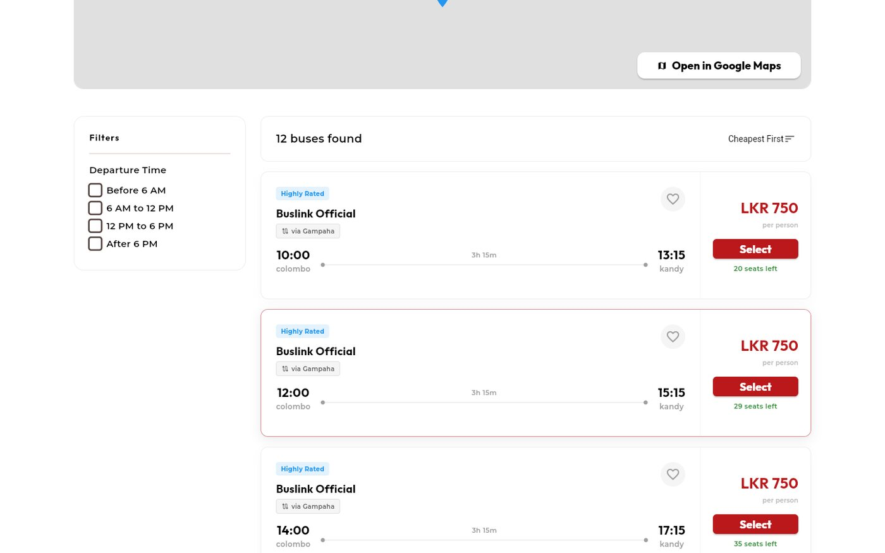</a>

The results show every bus with its times, price and seats left. A heart saves the route. Filters narrow it by time of day.

<a href="docs/images/seats.jpg"></a>

The seat picker is a real bus layout. Taken seats are crossed out, and the bottom bar shows what you have chosen and the total.

<a href="docs/images/my-trips.jpg">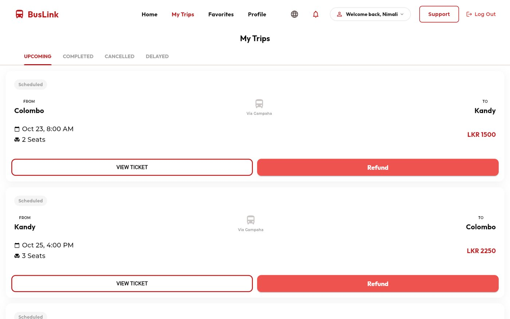</a>

<a href="docs/images/ticket.jpg"></a>

**My Trips** keeps upcoming, completed, cancelled and delayed journeys. The ticket has a QR code for the conductor, a **Track Bus Live** button and a PDF download.

<a href="docs/images/refund.jpg">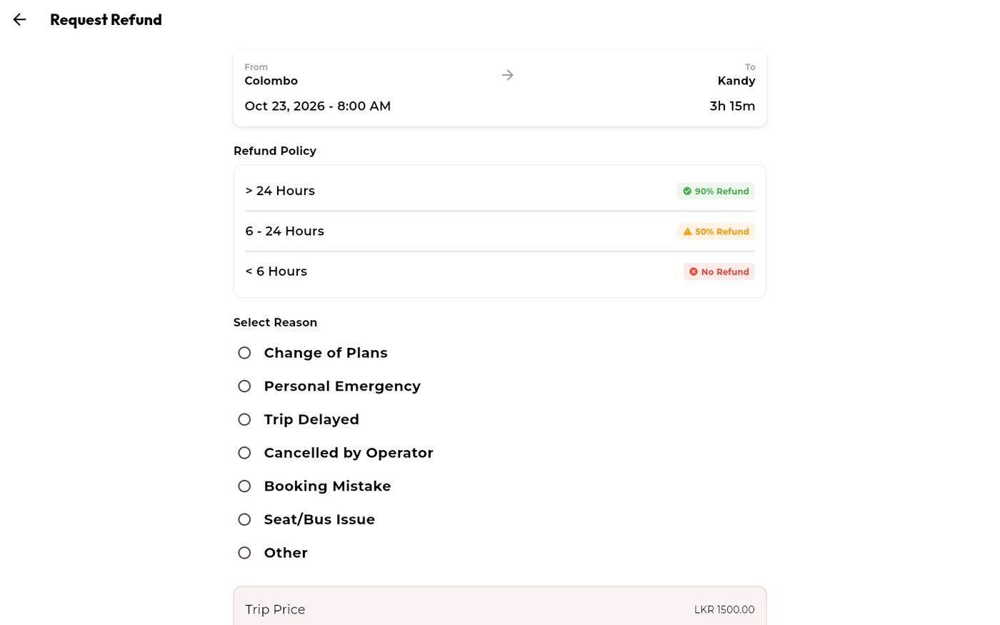</a>

A refund request shows the policy first, then asks for a reason.

<p align="center">
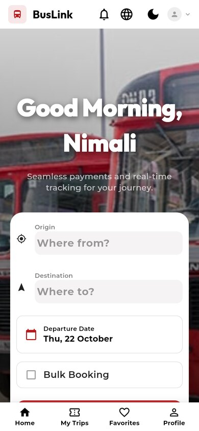
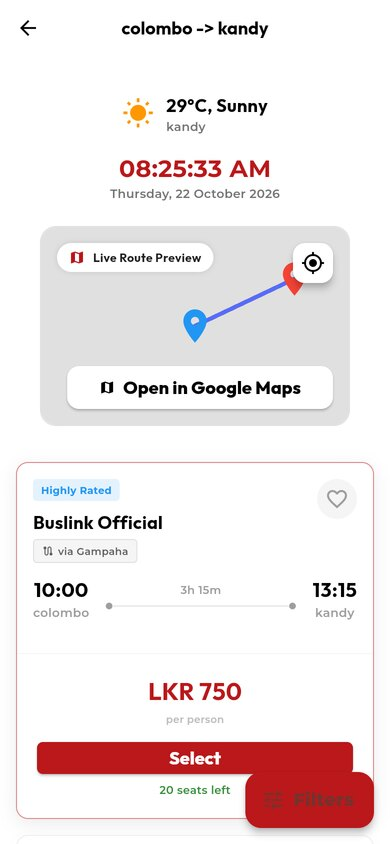
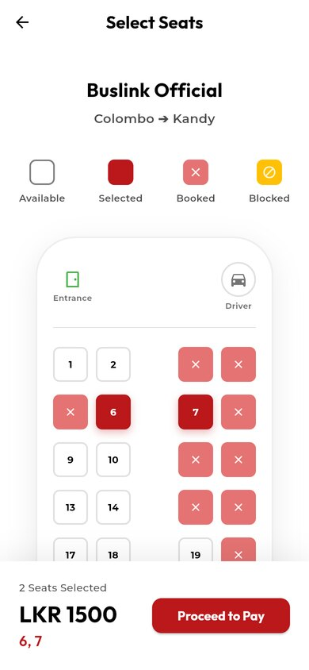
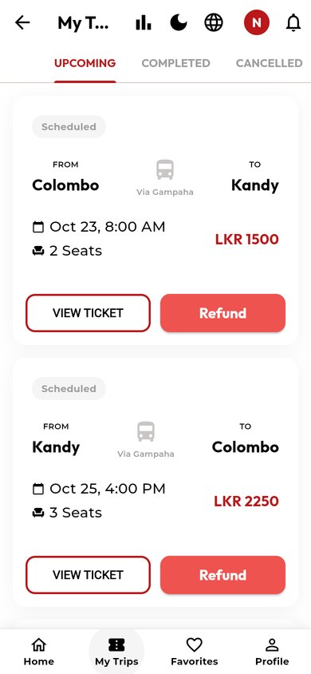
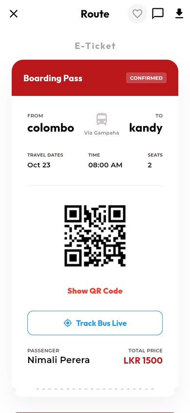
</p>

On a phone the same screens fold into one column with a bottom bar.

### Conductors

<a href="docs/images/conductor.jpg"></a>

A conductor scans the QR code with the camera, or types the short ticket code, and sees at once whether the ticket is valid. They can also find their trips to set status and delays, and take walk-up bookings.

### Admins

<a href="docs/images/admin-dashboard.jpg"></a>

<a href="docs/images/admin-routes.jpg">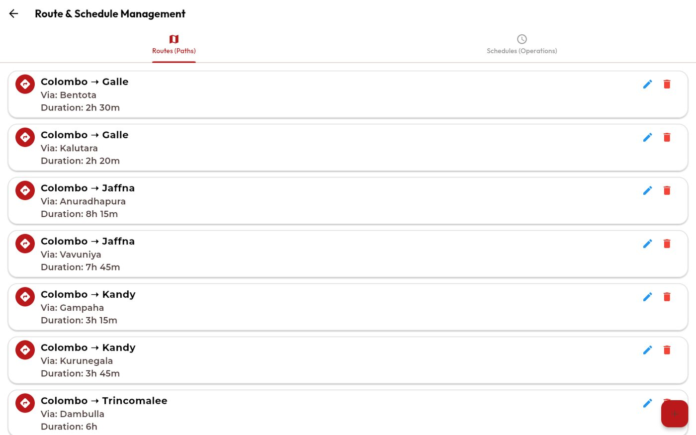</a>

<a href="docs/images/admin-bookings.jpg">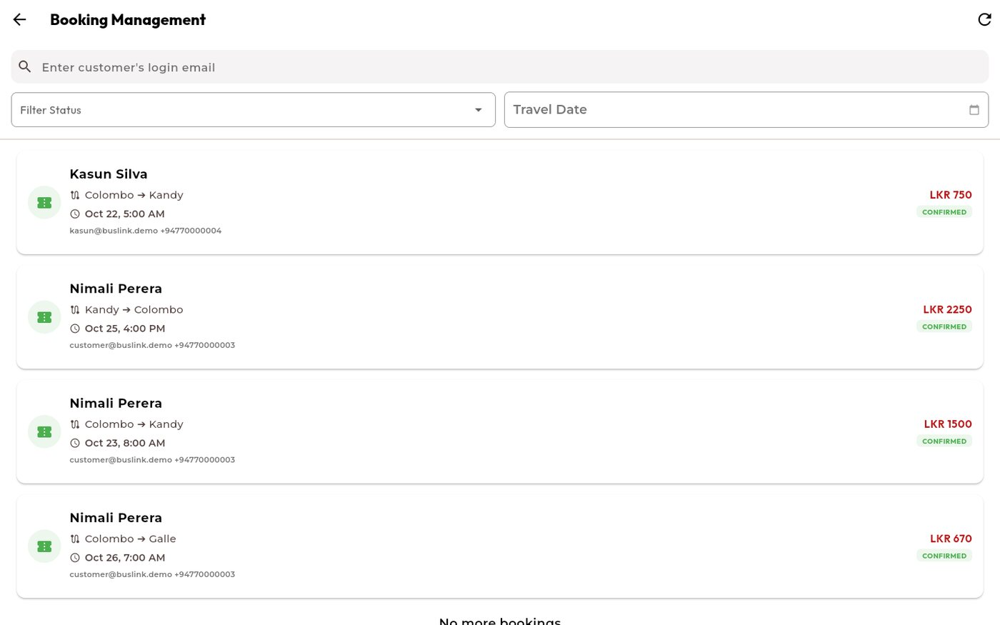</a>

<a href="docs/images/admin-refunds.jpg">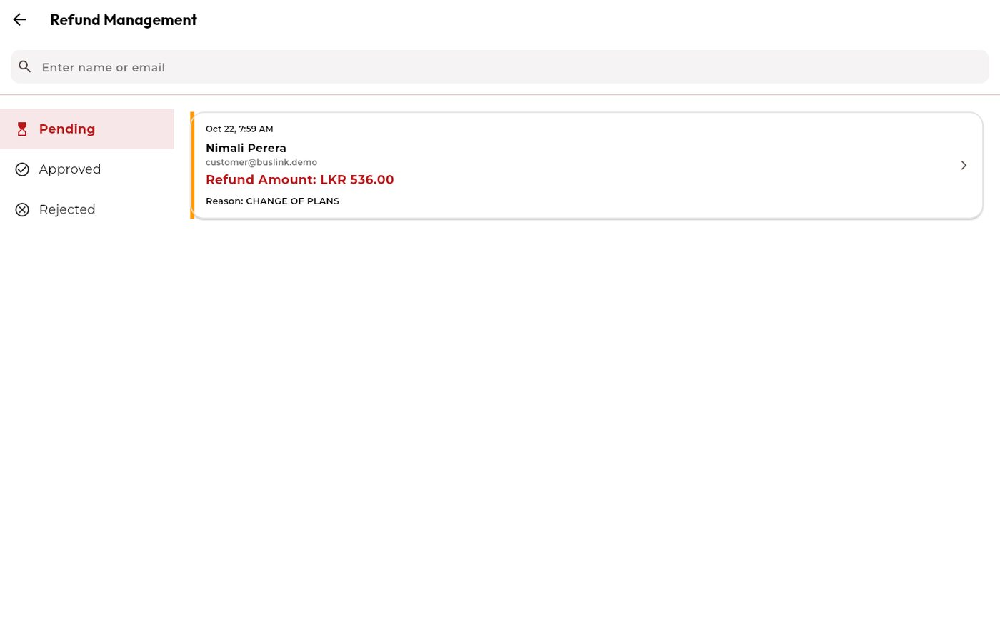</a>

<a href="docs/images/admin-analytics.jpg">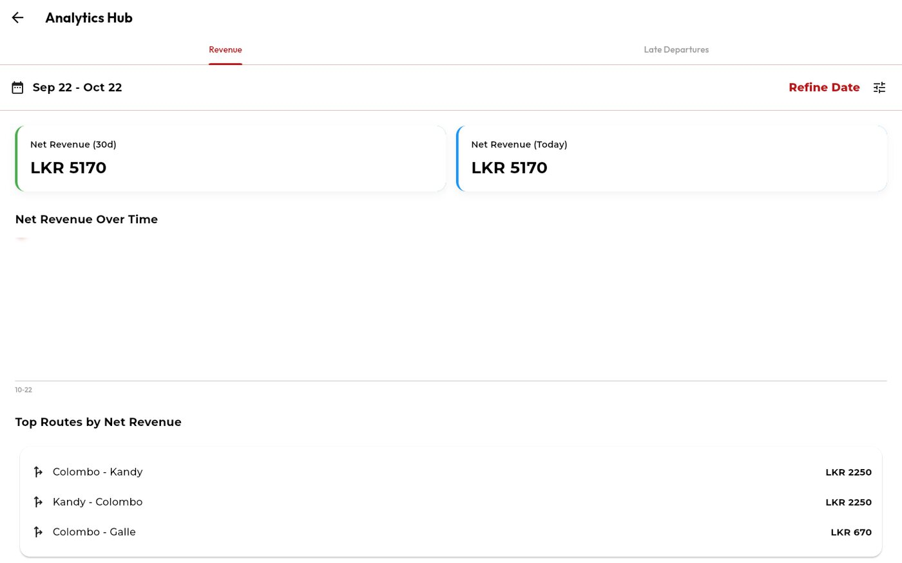</a>

<a href="docs/images/admin-users.jpg">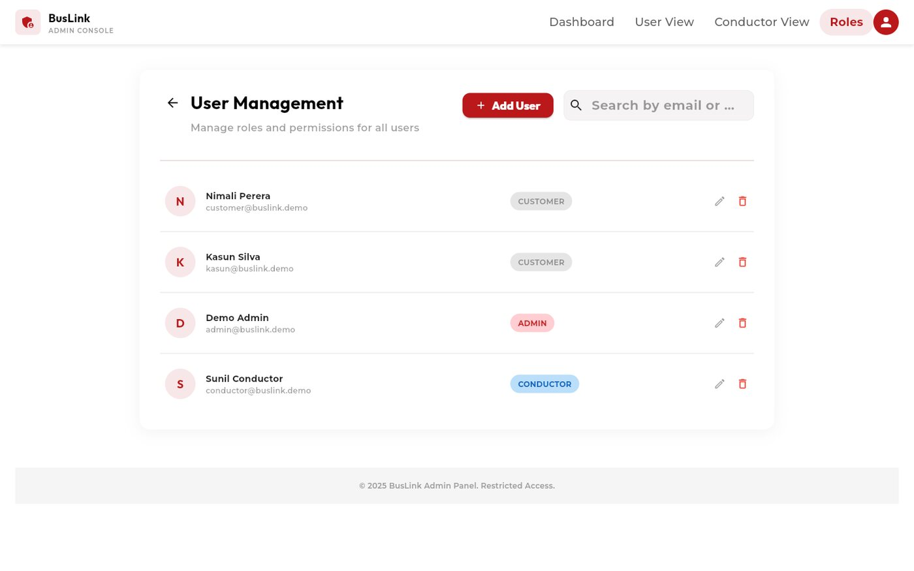</a>

Admins create routes and schedules (trips are then made from the schedules), look at every booking, review refund requests, read revenue and late-departure analytics, read feedback and change user roles. A **Preview App** button shows what a passenger sees.

More: [feedback inbox](docs/images/admin-feedback.jpg), [login screen](docs/images/login.jpg), [profile](docs/images/profile.jpg). A walk through every screen is in [Using the app](docs/Using%20the%20app.md).

## Run it with your own Firebase and Stripe

You need a Firebase project (Auth, Firestore, Cloud Messaging) and a Stripe account in test mode. The steps are in **[docs/SETUP.md](docs/SETUP.md)**. In short:

```bash
flutterfire configure          # writes lib/firebase_options.dart (git-ignored)
# create a .env file (the build fails without it), see docs/SETUP.md for the keys
firebase deploy --only firestore:rules,firestore:indexes
cd scripts && npm install && node seed_master_data.js && node generate_trips.js
flutter run -d chrome
```

## Tech stack

| Area | Choice |
|---|---|
| App | Flutter (Material 3), `provider`, `get` |
| Auth | Firebase Auth (email, Google, phone) |
| Data | Cloud Firestore with offline persistence |
| Payments | `flutter_stripe`, Stripe Checkout |
| Notifications | `firebase_messaging`, `flutter_local_notifications` |
| Maps and location | `flutter_map`, `latlong2`, `geolocator`, `google_maps_flutter` |
| Tickets | `qr_flutter`, `mobile_scanner`, `pdf`, `printing` |
| Serverless | Firebase Cloud Functions (`functions/`), Vercel functions (`api/`) |
| i18n | Flutter `gen-l10n` (`lib/l10n/*.arb`), English, Sinhala, Tamil |
| Web hosting | Vercel (`vercel.json`, `build_vercel.sh`) |

## Known issues and security notes

This started as a coursework build. Read these before using it with real money.

- **Secrets in the client.** `STRIPE_SECRET_KEY` and `FIREBASE_SERVICE_ACCOUNT_BASE64` are read from `.env`, which is bundled into app builds. Anyone can extract them. Use test-mode keys only, and move refunds and push sending to Cloud Functions or the Vercel API.
- **Unauthenticated refund endpoint.** `api/refund.js` allows any origin and does not check who is calling.
- **Refund function has no admin check.** `functions/index.js` only needs a signed-in user (the admin check is commented out).
- **Role escalation.** `firestore.rules` lets a user write their own `users/{uid}` document, including `role`. Restrict `role` to admins.
- **Hard-coded admin email** in `firestore.rules` and `lib/main.dart`.
- **Seats are never given back.** The code only adds seats to a trip's `bookedSeatNumbers`. An abandoned payment keeps its seats held, and a refund does not free them. See the [FAQ](docs/FAQ.md).
- **A hidden debug login was removed from release builds.** `login_screen.dart` had an almost invisible button that signed in as `admin@buslink.com`, `conductor@buslink.com` or `test@test.com` with the password `123456`. It now only exists in debug builds. If those accounts exist in your real Firebase project, change their passwords or delete them.
- **A broken font file.** `assets/fonts/Inter-Variable.ttf` is a saved web page, not a font. The app falls back to another font. Download the real Inter from <https://rsms.me/inter/> to fix it.
- **The unit test needs Firebase.** `flutter test` runs `test/widget_test.dart`, which fails without a Firebase project. `flutter analyze` is clean.
- **The root folder has old one-off scripts** (`repair_*.py`, `fix_*.py` and others) that are not part of the app.

Never commit `.env`, `service-account.json` or `firebase_options.dart`. To report a security problem, read [SECURITY.md](SECURITY.md).

## Help and more reading

| If you want to | Read |
|---|---|
| Try it with no accounts | [Demo mode](docs/Demo%20mode.md) |
| Set up your own Firebase and Stripe | [Setup guide](docs/SETUP.md) |
| Understand how it is built | [Architecture](docs/ARCHITECTURE.md) |
| Walk through every screen | [Using the app](docs/Using%20the%20app.md) |
| Set up Stripe | [Stripe setup](STRIPE_SETUP.md) |
| Fix a problem | [Fixing problems](docs/Fixing%20problems.md) |
| Find a quick answer | [Questions and answers](docs/FAQ.md) |
| Change the code | [Contributing](CONTRIBUTING.md) |
| See what changed | [Changes](CHANGELOG.md) |

## Contributing

Fixes and ideas are welcome. Read [CONTRIBUTING.md](CONTRIBUTING.md) first.

## Credits

Built with [Flutter](https://flutter.dev), [Firebase](https://firebase.google.com) and [Stripe](https://stripe.com). Map data comes from [OpenStreetMap](https://www.openstreetmap.org) contributors. Photographs belong to their owners and are loaded from their original sites.

## Licence

No licence file yet, so for now all rights are reserved by the author.

Built by [Yusuf (Hikki-dev)](https://github.com/Hikki-dev).
