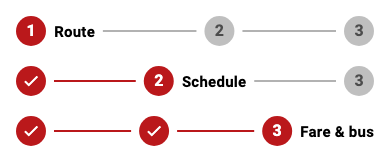
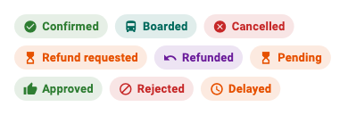

# Admin guide

How the people who run the buses use the admin screens: add trips, watch bookings, process refunds and manage who can do what.

An account becomes an admin when its `role` is `admin` (see [Roles](Installing.md#7-roles)). On sign-in an admin lands on the admin dashboard. The menu in the top bar switches between **Dashboard**, **User View** (see the app as a passenger), **Conductor View** and **Roles**.

## On this page

* [Add or edit a trip](#add-or-edit-a-trip)
* [Routes and timetables](#routes-and-timetables)
* [Bookings](#bookings)
* [Refunds](#refunds)
* [Roles and users](#roles-and-users)
* [Reports](#reports)
* [Feedback](#feedback)
* [Reading the status chips](#reading-the-status-chips)

## Add or edit a trip

The trip form has three short steps, shown at the top:

**Step 1: Route.**

* Optionally load everything from a **saved route**.
* Choose **From** and **To**. Start typing a city and pick from the list.
* Choose the road it takes (**Via**) and how long it takes, in hours and minutes.

**Step 2: Schedule.**

* Choose the departure time. The arrival time follows from the trip length.
* Choose **Recurring route** (a weekly timetable: tick the days it runs) or **One-time trip** (pick one date). When you edit an existing trip it is always one trip, so there is no choice.

**Step 3: Fare and bus.**

* Set the fare in LKR and the total number of seats.
* Block seats that should not be sold, on the seat layout.
* When editing, also set the **Trip status**.
* Press **SAVE TRIP** (or **SAVE CHANGES** when editing).

How the steps behave:

* **Next** only checks the fields you can see. If a required one is empty it shows "Required" and stays where it is.
* **Back** keeps everything you typed.
* Nothing is saved until the last step.

One thing to know: in the **Via** box, choose an option from the list (or press Enter after typing it). Text that is typed but not chosen is not remembered if you go Back and forward.

## Routes and timetables

A **route** is a city-to-city line (origin, destination, via, distance, usual travel time, active or not). A **schedule** is a bus on a route with its weekly days, departure time, base price and seats. **Trips** are the individual runs on specific dates, made from schedules.

Create and edit routes from the routes screens on the dashboard. A script (`scripts/generate_trips.js`) creates the next 30 days of trips from the schedules. Run it again from time to time so future dates stay available. See [Installing](Installing.md#6-seed-data).

## Bookings

The bookings list shows every ticket. Search by passenger, and filter by status.

Each row shows the passenger, the route, the departure time, the amount and a **status chip**. A confirmed ticket that has been checked in shows **Boarded**. Open a row for the full details.

## Refunds

Passengers send refund requests. The list has three tabs: **Pending**, **Approved** and **Rejected**. Each card shows the date, the passenger, the amount, the reason and a status chip.

Open a request to read it in full, then:

* **Approve** it. The money is returned to the passenger's card through Stripe, and the ticket is marked refunded.
* **Reject** it. The passenger sees "Rejected" on their refund progress line.

Every refund sent to Stripe is also recorded in an admin-only list, `refund_transactions`, so there is a trail.

## Roles and users

Open **Roles** in the menu to see everyone and change who is a conductor or admin. The change takes effect the next time that person's app checks, which is immediately for anyone with the app open.

Only admins can change roles. A person can never change their own.

## Reports

* **Revenue:** how much has been paid, over time.
* **Late departures:** which trips left late and by how much, to spot routes that need attention.

## Feedback

The feedback inbox lists what passengers sent from the profile screen. Only admins can read it.

## Reading the status chips

Every status is an icon, a word and a colour together.

| Chip | Where | Means |
|---|---|---|
| Confirmed | Booking | Paid and valid |
| Boarded | Booking | Checked in by a conductor |
| Cancelled | Booking, trip | Cancelled |
| Refund requested | Booking | The passenger asked for a refund |
| Refunded | Booking | The refund was paid out |
| Pending | Refund | Waiting for an admin |
| Approved | Refund | Approved |
| Rejected | Refund | Declined |
| Delayed | Trip | Running late |

A status the app does not know is shown as plain grey text with a question mark, never hidden.
