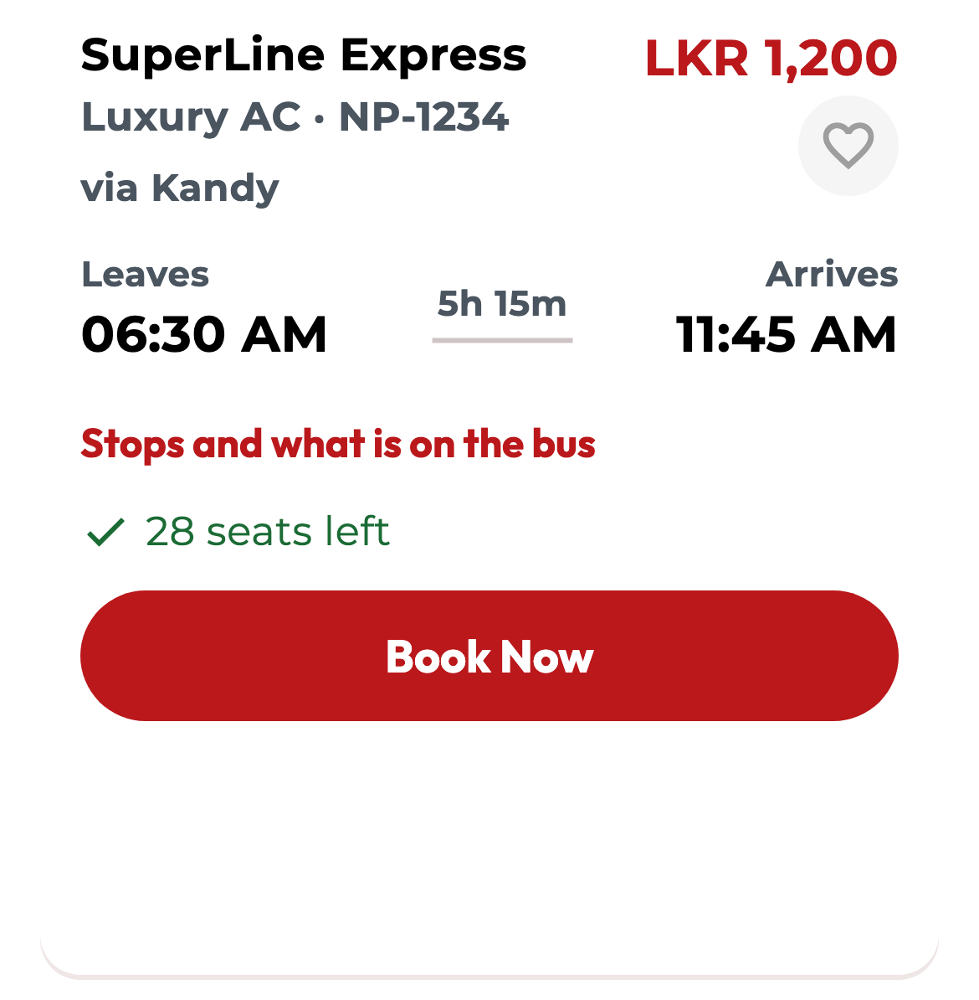

# Passenger guide

Everything a passenger can do, screen by screen, in the order they usually do it.

## On this page

* [Sign in](#sign-in)
* [Find a bus](#find-a-bus)
* [Choose your seats](#choose-your-seats)
* [Pay](#pay)
* [Your ticket](#your-ticket)
* [My Trips](#my-trips)
* [Track the bus](#track-the-bus)
* [Ask for a refund](#ask-for-a-refund)
* [Favourites, notifications and settings](#favourites-notifications-and-settings)
* [Book several dates at once](#book-several-dates-at-once)

## Sign in

You can sign in three ways: email and password, a Google account (the button uses the real Google "G"), or a phone number with a code sent by text.

Choose English, Sinhala (සිංහල) or Tamil (தமிழ்) with the three buttons at the top of the sign-in page. Your choice is remembered, and can be changed later in your profile.

A new account is always a passenger. Nobody can pick a higher role for themselves.

## Find a bus

On the home screen choose where you are leaving from, where you are going and the date, then press **Search**. The small swap button in the middle turns the two cities around.

Each result is a bus card:

* The top line is who runs the bus. Under it are the bus type and number, and the road it takes (for example "via Kandy").
* The times are in 12-hour format, with how long the trip takes in between.
* The price is per person.
* The line under the button says how many seats are left: green when there are plenty, red when only a few remain.

If something is wrong, the card says so in words:

A **cancelled** bus and a **full** bus have a grey button that cannot be used. Pressing it explains why.

## Choose your seats

* White seats are free. Tap to choose.
* Grey seats with a cross are taken. They cannot be chosen.
* Red seats with a tick are the ones you chose.

The map updates live. If someone takes a seat while you are choosing, it turns grey.

Seats are held for you only at the moment you continue. If two people try for the same seat at the same moment, one of them is told it is gone and can pick another. See [How everything fits](How%20everything%20fits.md#booking-and-payment-flow).

## Pay

Pay by card. Card details go straight to Stripe. BusLink never sees them.

* On the **phone app** a payment sheet opens.
* On the **web** you are taken to Stripe's secure page and sent back when you finish.

Prices are in Sri Lankan rupees (LKR). The app asks for at least LKR 150, and Stripe itself needs about 50 US cents (around LKR 165), so a very small amount is refused on the card page.

## Your ticket

After paying you see "Payment Confirmed" and your ticket:

* a **QR code** the conductor scans, and
* a **4-character code** to say out loud or type, if scanning does not work.

The ticket can be saved as a PDF. It is also always in **My Trips**.

## My Trips

Each trip is one card.

* **View** opens the ticket. It is the main button.
* **Track bus** only appears when it is useful: the bus is on its way, is running late, or leaves within three hours.
* **Refund** is a small link, kept quiet on purpose so it is not pressed by accident. It does not appear on cancelled trips.

The badge at the top uses an icon and a word, never colour alone.

## Track the bus

**Track bus** opens a full-screen map with one card at the bottom.

* The bus appears on the map as a pulsing red dot, using the location the conductor's phone reports for that trip.
* The card shows how long is left ("42 min" or "1 h 05 min"). This is worked out from the timetable plus any delay the conductor reported.
* **Share** copies a short message you can send to the person meeting you.
* The target button centres the map on the bus again.

## Ask for a refund

Press **Refund** on a trip, choose a reason and send it. Then open the refund to see where it is:

1. **Sent**: BusLink has your request.
2. **In review**: an admin is looking at it.
3. **Approved** or **Rejected**.

An approved refund is sent back to your card through Stripe. If it fails, the screen says so, and you can contact support.

## Favourites, notifications and settings

* **Favourites** keep routes you travel often. Press **Book again** on one to search that route.
* **Notifications** tell you about delays, cancellations and refund updates. You can choose which in **Notification Settings**.
* **Profile** has Account Settings (name and phone), language, dark mode, feedback and Log Out.
* **Support** has answers to common questions and emergency hotlines: Police 119, Suwa Seriya ambulance 1990, Fire and Rescue 110 and the NTC hotline 1955.

## Book several dates at once

For a regular journey, use bulk booking on the home screen: pick the dates on a calendar and the number of seats, check the summary, and pay once. Each date gets its own ticket.
