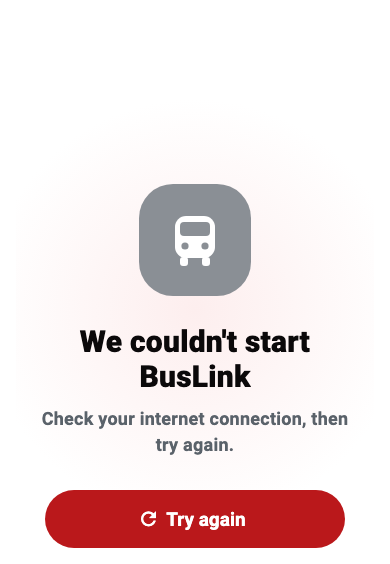

# Starting up

What you see when BusLink opens, what is happening behind it, how it was made faster, and the rules that keep it fast.

## On this page

* [What you see](#what-you-see)
* [What happens while it shows](#what-happens-while-it-shows)
* [What changed, and how much it helped](#what-changed-and-how-much-it-helped)
* [What is still slow](#what-is-still-slow)
* [The rules for keeping it fast](#the-rules-for-keeping-it-fast)
* [How to measure it yourself](#how-to-measure-it-yourself)
* [If it does not start](#if-it-does-not-start)

## What you see

BusLink used to show a white page with a small spinning circle for several seconds. Now it shows a short scene: the logo pops in, then the name, then a bus drives along a little road from Colombo to Kandy to Ella. The stops light up as the bus reaches them, and a line says **Getting things ready**.

It was designed on the design canvas (boards 35 and 36, "Starting up") and built twice from the same drawing: once in the web page itself, so it shows from the very first paint while the app is still downloading, and once in Flutter, for phones and desktop.

There are two other states, both in plain words.

**Slow.** After 8 seconds, the line changes to say so:

**Could not start.** If something essential fails, or 30 seconds pass, there is a real error screen with one big button, instead of an app that opens broken:

If the phone is set to **reduce motion**, nothing moves. The same picture is held still, with the bus parked at Kandy.

The screen is always light, because the app always opens in light mode. A dark splash flashing into a light app would be jarring.

## What happens while it shows

Everything the app needs before its first real screen starts **at the same moment**, so the app is ready when the slowest one is, not after all of them one by one.

| Step | What it does | If it fails |
|---|---|---|
| `cache` | Reads the settings saved on this device | The app opens anyway |
| `dates` | Loads date names for English, Sinhala and Tamil | The app opens anyway |
| `env` | Reads the `.env` file (the Stripe key) | The app opens anyway |
| `firebase` | Starts Firebase and turns on the offline cache | "We couldn't start BusLink" |
| `auth` | Waits once for Firebase to say who is signed in | The app opens anyway |

Only Firebase can stop the app, because without it there is no sign-in and no data.

Slower work that is not needed to draw the first screen starts **after** it: push notifications, Stripe and Google sign-in (`BackgroundServices` in `lib/app/background_services.dart`).

Two details make the first screen the right one:

* Waiting once for `auth` means a signed-in person goes straight to their home, instead of seeing the sign-in page flash up first.
* The app now remembers each person's role on the device. A returning person sees their home screen straight away while the role is checked, instead of a loading screen. If the check disagrees (for example an admin made them a conductor), the screen switches. Signing out forgets it.

## What changed, and how much it helped

| What | Before | After |
|---|---|---|
| What the page shows for the first seconds | A bare spinner | The animated scene above |
| Fonts the browser downloads before drawing | 7 files, including a Noto Sans of 1.1 MB (compressed) that no screen used | 6 files |
| Sign-in photos | 5 photos downloaded at once, 0.3 to 1.5 MB each (2.8 MB in the test) | Only the photo on screen, at web size (0.16 to 0.8 MB, 0.25 MB in the test). The next one is fetched a few seconds later |
| Firebase's scripts | Started downloading after the app had drawn | Started at the same time as the app |
| Stripe's script | Loaded in a way that could hold the page up | Loads in the background |
| Start-up steps | One after another | All at once |
| Repeat visits | Every font and image asked "has this changed?" | Fonts and images are reused for a day |
| `main.dart` | 532 lines doing everything | About 15 lines. The rest is in `lib/app/` |

**Measured** three times: on the old live app, on a preview of this change, and on the live app after it went out. Each was cold (nothing cached), on a phone-sized screen, with the network slowed to "Fast 4G" and the processor slowed 4 times.

| Moment | Before | After |
|---|---|---|
| First thing you can read on screen | 6.0 s | **2.5 s** (2.46 s on the preview, 2.49 s live) |
| The app draws its first frame | 5.3 to 5.4 s | 5.0 to 5.7 s (no real change) |
| The sign-in screen is built | 7.1 to 7.7 s | 6.8 to 7.3 s (no real change) |
| The sign-in photo is showing | 8.7 to 11.3 s | **7.4 to 7.7 s** |
| Data downloaded, as the browser reports it | 3.2 MB | **0.5 to 0.7 MB** |

These are single runs on a slowed-down computer, and the same page varies by about 0.7 seconds from run to run. Read them as the size of the change, not exact seconds.

**What this does and does not show.** The big win is what you see while you wait: a designed screen after 2.5 seconds instead of nothing readable for 6. The data and the sign-in photo improved a lot too. But the app's own first frame and the moment the sign-in screen is built **did not get measurably faster**. That wait is the app and its graphics engine downloading and starting, which this change does not shrink. See the next section.

## What is still slow

Most of the wait that is left (about 5 seconds on this slowed-down test) is two downloads that no setting makes small:

* **The app itself** (`main.dart.js`), about 6.4 MB (1.6 MB compressed), which the browser then has to read and prepare.
* **CanvasKit**, the engine Flutter uses to draw on the web, which is another large download of its own.

Ideas that would help, none done yet, and not worth doing blindly:

1. **Load the admin and conductor screens only when needed** (Dart's deferred loading). Most visitors are passengers and never need them. This could take a meaningful slice out of the app download. It changes how those screens open, so it needs careful tests.
2. **Try the WebAssembly renderer** (`flutter build web --wasm`). It can start faster, but several plugins here (Google sign-in, Stripe, Firebase) need checking first.
3. **Narrow the date data.** `dates` loads names for every language, but only three are used. Naming only the three can break on a phone set to a different regional language, so it needs a fallback.

Measure before and after each one, as below.

## The rules for keeping it fast

1. **Nothing slow runs before the first screen.** If it is not needed to draw the first screen, it goes in `BackgroundServices`, not in the start-up steps.
2. **A new start-up step says whether it is critical.** Critical means "the app cannot work without it". Everything else is optional: it is logged and the app opens without it.
3. **Steps run at the same time.** If one needs another, say so with `after`. Do not await one inside another.
4. **Do not hide a failure.** A critical failure shows the failure screen. It must never open a half-working app.
5. **The splash is never the only way to tell something went wrong.** The slow and failed states have words and a button.
6. **Keep the splash and the web page in step.** The drawing in `web/index.html` and the painter in `lib/views/splash/route_painter.dart` are the same picture. Change one, change the other, and the design board.
7. **Be careful with new fonts and big images.** Fonts listed in `pubspec.yaml` are downloaded before the first frame. Only declare a font the app actually uses.
8. **Keep the Firebase version in `web/index.html` in step with the app.** The `modulepreload` lines name a version (see `firebase_core_web` in `pubspec.lock`). A stale version only wastes a little bandwidth.

To add a step, add a `StartupStep` in `lib/app/startup_steps.dart` and a test in `test/startup_test.dart`.

## How to measure it yourself

Use Chrome with its developer tools, so the test is the same each time.

1. Open the page in a new Incognito window, so nothing is cached.
2. In the developer tools, turn on the phone view (390 by 844), set the network to **Fast 4G**, and set the CPU to **4x slowdown**.
3. Reload. Note when the splash appears, when it fades, and when the sign-in page is ready.
4. In the Network tab, look at the total transferred and the biggest files.

For a pull request, Vercel gives every branch its own address, so you can measure the change before it goes live and compare it with the live app under the same settings.

## If it does not start

| You see | Do this |
|---|---|
| The splash for a long time, then "Still getting ready" | The connection is slow. Wait, or reload |
| "We couldn't start BusLink" | Check the internet connection and press **Try again**. If it keeps happening, see [Fixing problems](Fixing%20problems.md#the-live-demo) |
| The splash, then a white page | Open the browser's console. A Firebase or `.env` problem is logged there. See [Fixing problems](Fixing%20problems.md) |
| The splash is dark, or missing | It should always be light. Clear the browser's cache and reload |
