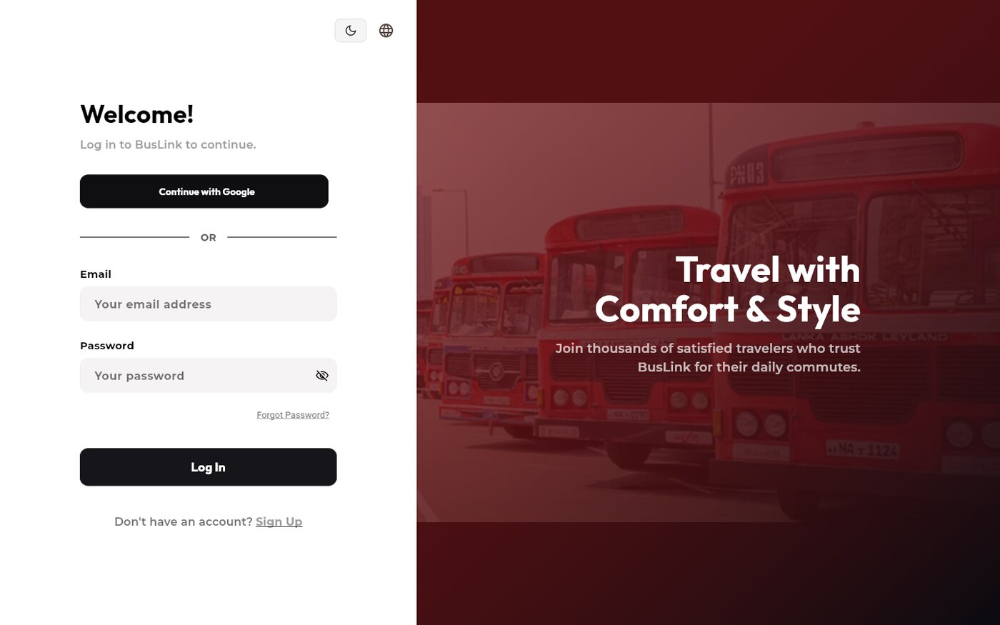
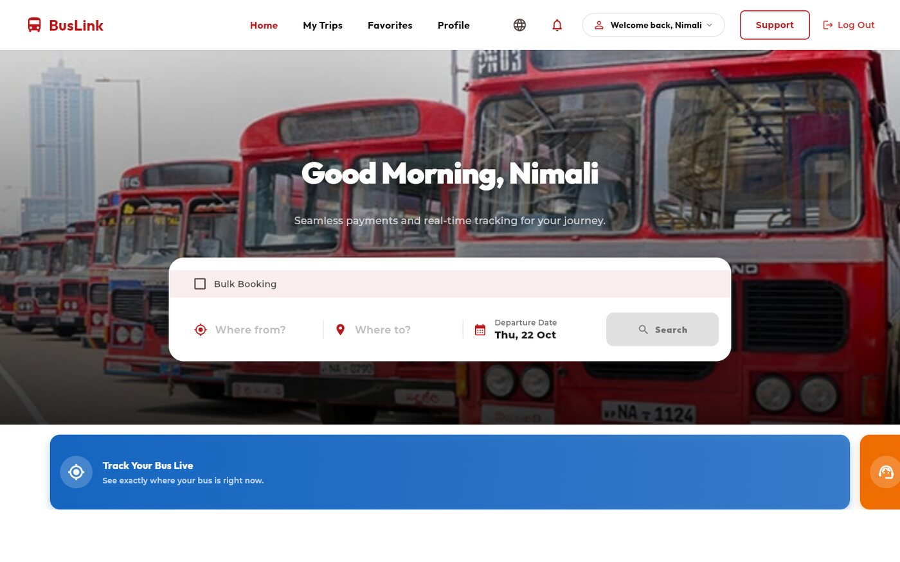
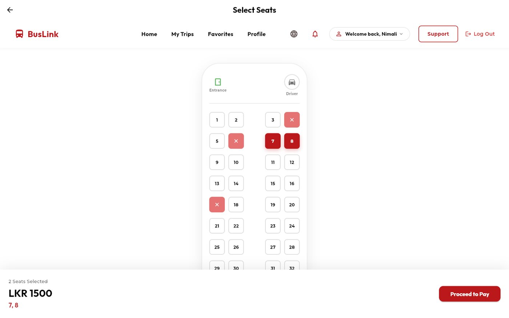
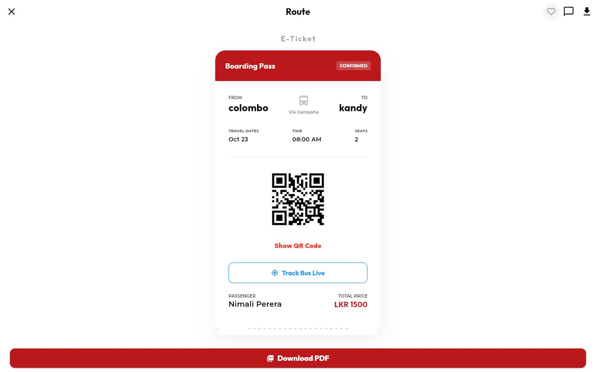
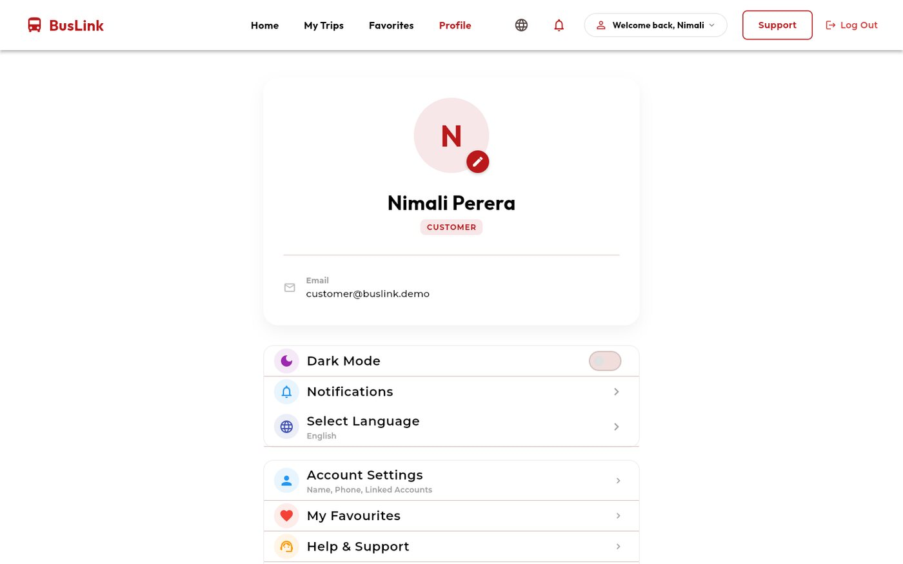
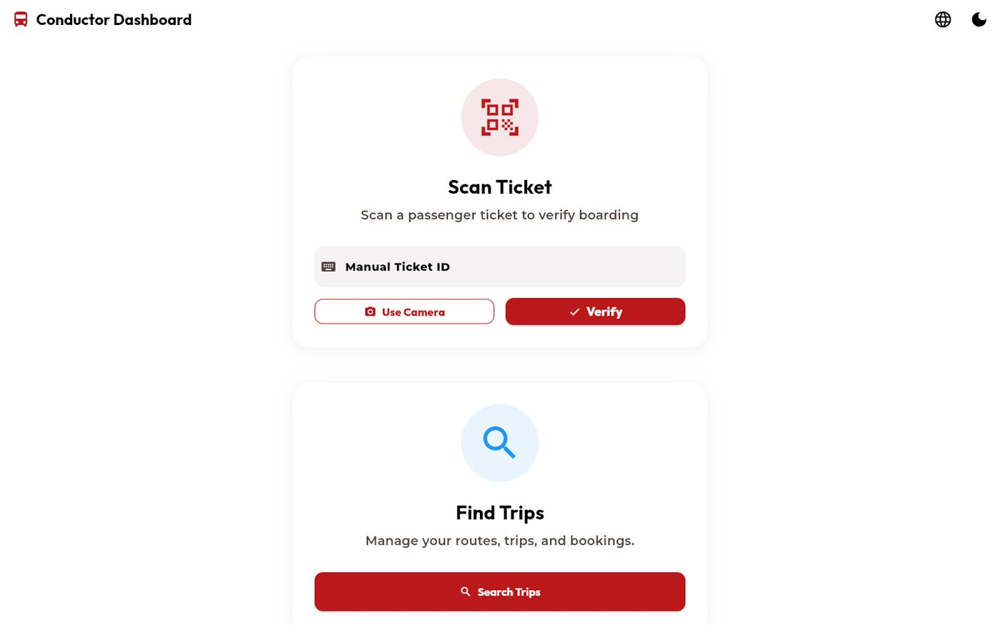
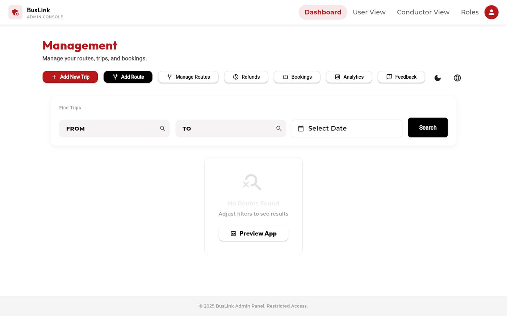

# Using the app

A walk through every screen, by role. The pictures are from [demo mode](Demo%20mode.md).

## Passengers

### Sign in

Sign in with an email and password, with Google, or with a phone number and a one-time code. **Sign Up** makes a new passenger account. The globe button switches between English, Sinhala and Tamil, and the moon switches to dark mode.

### Find a bus

1. On **Home**, type where you are going from and to, and pick each city from the list.
2. Pick the date. To book the same route on several days, tick **Bulk Booking** and pick the days.
3. Press **Search**.

The results list every bus for that route and date, with the weather at your destination, a map of the route, the times, the price and the seats left. Filter by time of day, sort by price, and tap the heart to save a route to **Favorites**.

### Pick seats and pay

1. Press **Select** on a bus.
2. Tap the seats you want. Crossed-out seats are taken, and yellow ones are blocked.
3. Press **Proceed to Pay**. The seats are held for you while you pay.
4. On a phone you pay with the Stripe payment sheet. On the web you are sent to Stripe Checkout and back.

### Your tickets

**My Trips** has four tabs: Upcoming, Completed, Cancelled and Delayed. **View Ticket** opens the boarding pass with a QR code, the route, date, time and seats. From there you can download a PDF, send feedback, or press **Track Bus Live**.

### Ask for a refund

Press **Refund** on an upcoming trip. The policy is shown first: more than 24 hours before departure you get 90% back, 6 to 24 hours 50%, and under 6 hours nothing. Choose a reason (change of plans, personal emergency, trip delayed, cancelled by the operator, booking mistake, seat or bus issue, or other) and send it. You can follow the request's status from the trip.

### Profile

Change your name and photo, switch dark mode, choose notifications and language, open account settings, favourites and help.

## Conductors

A conductor opens the **Conductor Dashboard**.

* **Scan Ticket:** press **Use Camera** and scan the passenger's QR code, or type the short ticket code and press **Verify**.
* **Find Trips:** open a trip to change its status, set a delay, or add a walk-up passenger who has no app (an offline booking).

## Admins

The **Admin Console** opens on **Management**. The row of buttons leads to everything.

| Button | What it does |
|---|---|
| **Add New Trip** | Make a one-off trip, or a recurring route with operating days, times, a price and a seat layout |
| **Add Route** and **Manage Routes** | Create, edit and remove routes, and manage the schedules that trips are made from |
| **Refunds** | Review requests in three tabs (Pending, Approved, Rejected). Approving sends the money back through Stripe |
| **Bookings** | Search every booking by the customer's email, filter by status and travel date |
| **Analytics** | Revenue for a date range, top routes by revenue, and a Late Departures view |
| **Feedback** | Read what passengers wrote, with their rating |
| **Roles** | Make someone a customer, a conductor or an admin |
| **Preview App** | See what a passenger sees |

Trips are made from schedules by the script `scripts/generate_trips.js`, for the next 30 days. Run it regularly (for example with a scheduled job) so there are always future trips to book.
